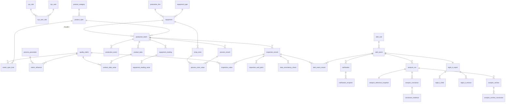

# PPR 质量智能分析助手 · MySQL 库表设计说明

面向 Node.js 前后端分离服务的数据库设计说明。

设计原则：**业务规则落到关系模型，凡是不确定的口径都建模为可配置项并记录可信状态**，而不是把阈值写死在代码或表结构里。

## 交付物

| 路径 | 内容 | 是否可执行 |
| --- | --- | --- |
| `migrations/` | **建库与变更的唯一可执行来源**：`0001_schema` … `0007_remove_demo_wording`，由 `pnpm db:migrate` 按序执行并记录校验和台账 | 是 |
| `schema.sql` | 全库结构总览（表、视图、索引、外键、中文注释），便于通读 | 否，仅供参考 |
| `tools/gen-seed.mjs` | 生成 `0002` 基线数据的脚本，改基线数据请改脚本后重新生成 | 是 |
| `tools/smoke-test.sql` | 写路径冒烟测试：事件 → 分析 → 结论 → 工程师验证 → 通知 → 8D → 归档 → 审计日志，末尾 `ROLLBACK` | 是 |

```bash
pnpm db:migrate                     # 建库 + 全部迁移（推荐路径）
pnpm db:check                       # 校验结构、基础数据与账号权限边界
pnpm migrate:resync                 # 迁移文件只改了注释时，同步台账校验和
mysql -uroot -p --default-character-set=utf8mb4 < tools/smoke-test.sql   # 可选，自校验
node tools/gen-seed.mjs             # 可选，重新生成基线数据 SQL（输出到 stdout）
```

> 读写一律带 `--default-character-set=utf8mb4`（Node 侧在连接池配置 `charset: 'utf8mb4'`），否则中文会显示为乱码。库内数据本身是正确的。

### 本地快速验证（无需本机装 MySQL）

本设计在一次性 Docker 容器中实测过，可用同样方式复现：

```bash
docker run -d --name ppr-db -e MYSQL_ROOT_PASSWORD=devroot \
  -v "$PWD/db:/sql:ro" mysql:latest
# 等待就绪（首次初始化约 30–60 秒）
docker exec -e MYSQL_PWD=devroot ppr-db mysql -uroot -e "SELECT VERSION();"

docker exec -e MYSQL_PWD=devroot ppr-db sh -c 'mysql -uroot < /sql/migrations/0001_schema.sql'
docker exec -e MYSQL_PWD=devroot ppr-db sh -c 'mysql -uroot --default-character-set=utf8mb4 < /sql/migrations/0002_seed.sql'
docker exec -e MYSQL_PWD=devroot ppr-db sh -c 'mysql -uroot < /sql/migrations/0003_platform_baseline.sql'
docker exec -e MYSQL_PWD=devroot ppr-db sh -c 'mysql -uroot --default-character-set=utf8mb4 < /sql/tools/smoke-test.sql'

docker rm -f ppr-db   # 验证完清理
```

正式环境不要手工按顺序执行 SQL，请用 `pnpm db:migrate`，它会记录校验和并在文件被改动时拒绝执行。

## 一、设计约定

1. **主键与业务键**：全表使用 `BIGINT UNSIGNED AUTO_INCREMENT` 代理键；业务编码（`CAT-PPR`、`SPEC-25-42`、`12121D0032`、`IR-001`、`QE-...`）保留为 `code` / `batch_no` / `sample_no` 等**唯一业务键**，接口对外仍按业务编码交互。
2. **字符集/引擎**：`InnoDB` + `utf8mb4` / `utf8mb4_0900_ai_ci`。
3. **时间**：统一 `DATETIME`（无时区），应用层按现场时区写入与展示；连接建立后 `SET time_zone='+08:00'`。不做 UTC 隐式转换，避免与 MES/QMS 的本地时间对不上。
4. **数值**：尺寸类 `DECIMAL(10,3)` / `DECIMAL(12,4)`，温度 `DECIMAL(8,2)`，压力 `DECIMAL(8,4)`，速度 `DECIMAL(8,2)`。全部用定点数，不用 FLOAT/DOUBLE。
5. **枚举 vs 字典**：封闭集合用 `ENUM`（风险类型、判定状态、报告状态等）；会增长的用字典表（质量指标、过程参数、温区、数据来源、预警规则）。
6. **测量值用长表**：`表头 + 指标值行`（如 `inspection_record` + `inspection_value`）。指标由 `quality_metric` 字典驱动，新增指标无需 `ALTER TABLE`；**某指标无数据 = 不写值行**，接口层直接返回"无数据"。
7. **主数据软删除**：`is_deleted`，避免删除规格/设备后打断历史批次、抽检与归档的引用链。
8. **模拟数据可追溯**：`data_source.is_simulated`、`inspection_value.is_simulated`、`notification.is_simulated`、`metric_spec_limit.limit_type='demo'`、`alert_rule.calibration_status='demo'`。早期方案反复强调 模拟数据 不得被当成正式生产能力，这里把它变成可查询的字段。
9. **不在数据库里做业务计算**：不生成复杂计算列、不写存储过程。生成列只用于纯恒等式（偏差、差值的绝对值）；趋势窗口、R1–R5 顺序判断、不圆度派生等放在 Node 服务层，阈值从 `alert_rule.params_json` 与 `metric_spec_limit` 读取。

## 二、ER 总览（10 组 / 42 表）



| 组 | 表数 | 表 |
| --- | --- | --- |
| A 权限与基础字典 | 5 | `sys_user` `sys_role` `sys_user_role` `data_source` `production_line` |
| B 产品与设备主数据 | 4 | `product_category` `product_spec` `equipment_type` `equipment` |
| C 指标与工艺参数字典 | 5 | `quality_metric` `metric_spec_limit` `process_parameter` `metric_influence` `temp_zone` |
| D 生产与数采 | 8 | `production_batch` `production_event` `product_data` `product_data_value` `equipment_reading` `equipment_reading_value` `process_record` `process_zone_value` |
| E 批量导入 | 1 | `import_job` |
| F 抽检与预警 | 9 | `inspection_record` `inspection_value` `inspection_wall_point` `data_consistency_check` `alert_rule` `alert_event` `alert_event_record` `notification` `notification_recipient` |
| G 诊断与工程师验证 | 4 | `analysis_run` `analysis_reference_snapshot` `analysis_conclusion` `conclusion_evidence` |
| H 8D 报告 | 3 | `eight_d_report` `eight_d_field` `eight_d_revision` |
| I 历史分析归档 | 2 | `analysis_archive` `analysis_archive_conclusion` |
| J 审计 | 1 | `operation_log` |

视图：`v_inspection_record_wide`、`v_product_data_wide`、`v_equipment_reading_wide`、`v_alert_event_detail`。

## 三、逐表说明

### A. 权限与基础字典

| 表 | 说明 | 关键约束 |
| --- | --- | --- |
| `sys_user` | 用户。早期方案里的"质量工程师 / 生产领班 / 设备工程师"是收件与确认角色 | `username` 唯一；`password_hash` 允许为空 + `must_reset_password`，**种子用户无密码，首登必须设置** |
| `sys_role` | 角色：admin / quality_manager / quality_engineer / production_leader / equipment_engineer / viewer | `code` 唯一 |
| `sys_user_role` | 用户角色关联（多对多） | 复合主键 |
| `data_source` | 数据来源字典。早期方案文案"生产录入 / MES模拟 / QMS模拟 / 本地 模拟数据 / 虚拟工艺数据"全部落在这里 | `code` 唯一；`is_simulated` 区分模拟与将来接入的真实来源 |
| `production_line` | 产线/工段。早期方案设备行只有文本 `lineName`，这里独立成表，支撑"同产线可比性"判断 | `code` 唯一 |

### B. 产品与设备主数据（系统管理 → 基础主数据）

| 表 | 说明 | 关键约束 |
| --- | --- | --- |
| `product_category` | 产品类别 [对应 categories] | `code` 唯一，软删除 |
| `product_spec` | 产品规格 25×4.2 [对应 specs]，含公称外径/壁厚/不圆度上限 | `code` 唯一；→ `product_category` |
| `equipment_type` | 设备类型 [对应 equipmentTypes] | `code` 唯一 |
| `equipment` | 设备台账 [对应 equipment] | `code` 唯一；→ `equipment_type`、`production_line` |

### C. 指标与工艺参数字典（基础主数据 → 质量指标与影响因素）

| 表 | 说明 | 关键约束 |
| --- | --- | --- |
| `quality_metric` | 指标字典。`metric_role`：`primary` 参与判定（外径/最小壁厚/不圆度）、`raw` 原始测点（最大/最小外径、最大壁厚）、`derived` 计算指标（不圆度 = 最大外径 − 最小外径） | `code` 唯一；`decimal_scale` 供前端格式化（对应早期方案 `fmt(n,3)`）；`check_direction_hint` 存早期方案的核查方向文案 |
| `metric_spec_limit` | **规格 × 指标**的上下限。早期方案把"适用规格列表 + 上下限"塞在同一指标行上，这里按 (规格, 指标) 归一化 | `(spec_id, metric_id)` 唯一；`limit_type`、`calibration_status` 标记待标定限值与待验证状态 |
| `process_parameter` | 过程参数（影响因素）字典：温度 / 压力 / 牵引速度 | `code` 唯一；`decimal_scale` 对应早期方案 `factorMeta.digits` |
| `metric_influence` | 指标 × 过程参数 [对应 metrics.influences 多选] | 复合主键 |
| `temp_zone` | 温区字典：M1 机筒 1–4 区、M1 适配器 1–4 区 | `code` 唯一；→ `equipment` |

### D. 生产与数采（数据源管理）

| 表 | 说明 | 关键约束 |
| --- | --- | --- |
| `production_batch` | 批次基础信息 [对应 batches] | `batch_no` 唯一（MES 自然键）；→ 规格/产线/挤出机/牵引机/来源；`batch_status` 为扩展 |
| `production_event` | **新增**：停机/换规格/调机事件 | `(batch_id, occur_time)` 索引。用于补上早期方案反复提示"运行连续性未确认"的缺口，是 R4 趋势判断的前置信息 |
| `product_data` | 产品数据 [对应 products] | **`(batch_id, production_date)` 唯一**，对应早期方案"一个产品只有一份"；`migrated_from` 保留早期方案迁移来源 |
| `product_data_value` | 产品指标值 [对应 products 的外径/壁厚/不圆度列] | `(product_data_id, metric_id)` 唯一 |
| `equipment_reading` | 设备采集表头 [对应 deviceReadings] | **`(batch_id, production_date, equipment_id, collect_time)` 唯一**，对应早期方案"设备编号 + 生产日期 + 采集时间唯一，每小时 1 条" |
| `equipment_reading_value` | 采集参数值（温度/压力/牵引速度） | `(reading_id, parameter_id)` 唯一。长表原因：参数由字典驱动，早期方案中挤出机行的牵引速度为 `null`，长表不必留空位 |
| `process_record` | 工艺过程记录 [对应 scenarios[].process] | `(batch_id, record_time)` 索引；`time_match_status` 对应早期方案"时间匹配待确认" |
| `process_zone_value` | 温区设定与反馈 | `(process_record_id, zone_id)` 唯一；`deviation_c` 为生成列（反馈 − 设定），与早期方案展示口径一致 |

> 早期方案中"牵引反馈速度"与"管材线速度"是两个**独立量**（后者不是牵引反馈），本设计分列保存，不互相换算；`mass_output_kgh` 也不能换算成米数。

### E. 批量导入

| 表 | 说明 | 关键约束 |
| --- | --- | --- |
| `import_job` | Excel 批量导入任务 [对应 下载模板/上传/校验/整批写入] | `status`：`validating → validated → committed`；早期方案规则"发现错误不写入任何数据"→ 只有 `validated` 才允许 `committed`；`error_summary` JSON 存逐行错误明细 |

### F. 抽检与预警（质量监控与预警 + R1–R5）

| 表 | 说明 | 关键约束 |
| --- | --- | --- |
| `inspection_record` | 样管抽检记录 [对应 record]。含样管编号、抽检时间、生产时间、检测延迟、初测/复测、检验方法与量具、数据质量标记 | **`(batch_id, inspect_time)` 唯一**，对应早期方案"批次 × 抽检时间"热力格每格一条；`sample_no` 不唯一（同一样管可初测+复测） |
| `inspection_value` | 抽检指标值 | `(record_id, metric_id)` 唯一；**无数据不写行**；`is_simulated` 对应早期方案 `dataValueType:'模拟值'`；`is_derived` 标记派生值 |
| `inspection_wall_point` | 多点壁厚原始测点（早期方案该字段恒为 `null`，此处预留） | `(record_id, point_no)` 唯一。用于区分"整体变薄"与"局部最薄处变化" |
| `data_consistency_check` | QMS/MES 记录核对 [对应 `qmsPair`，场景 C] | `diff_value` 生成列 = \|主值 − 副值\|；`tolerance_value` 保存**当时**的容差，便于追溯 |
| `alert_rule` | 预警规则 R1–R5 | `code` 唯一；`evaluate_order` 即"顺序判断"顺序；阈值存 `params_json`；`calibration_status` 标注未标定阈值；`rule_version` 供结论记录当时版本 |
| `alert_event` | 预警事件 [对应 buildEvents()] | `code` 唯一；**去重键 `(batch_id, rule_id, metric_id, window_start_time)`**：同批次同规则同指标同窗口只产生一条，窗口推进后可再次触发；`rule_code`/`rule_version`/`line_speed_mpm` 为触发时的快照 |
| `alert_event_record` | 事件关联抽检记录（触发点 + 窗口内可比较点） | `(event_id, record_id)` 唯一；支撑"证据可定位"（点击证据跳到趋势图） |
| `notification` | 通知（邮件/消息）[对应 showMail()] | `trigger_mode` 记录手动/自动；早期方案"中风险是否自动发送"待业务确认，故 `is_simulated` 默认 1 |
| `notification_recipient` | 收件人/角色与回执 | 支持按角色广播（收件角色=质量工程师、生产领班）与按人发送，含 `ack_status` |

### G. 诊断与工程师验证（异常诊断）

| 表 | 说明 | 关键约束 |
| --- | --- | --- |
| `analysis_run` | 一次"生成分析" [对应 state.ai + hypotheses[scenario]] | `(event_id, run_no)` 唯一，重新生成 = 新增 run 号，**不覆盖历史结论与工程师记录**；`generation_type` 区分本地规则 / 真实大模型，接大模型时记录 `model_name`、`prompt_version` |
| `analysis_reference_snapshot` | 参考版本快照 [对应 `analysisReference` / `referenceSnapshot()`] | `run_id` 唯一（1:1）。冻结当时的参考批次、样本数、中位数、观察范围、材料条件与方法——对应早期方案"更换当前参考不会修改本条工程师记录" |
| `analysis_conclusion` | 结构化结论 + 工程师验证 | `(run_id, seq)` 唯一；`hypothesis` 等 AI 原文与 `engineer_decision`、`validation_result`、`engineer_comment` **分列保存、互不覆盖**（早期方案明确要求两类信息独立） |
| `conclusion_evidence` | 结论依据/支持证据/反向证据 | `evidence_type`：`basis` / `support` / `contradict`；`layer` 对应早期方案分层（限值对照/变化趋势/参考对照/相关因素变化）；`fact_time` + `related_record_id` 支撑证据定位；`is_usable` 对应早期方案相关因素依据是否可用 |

### H. 8D 报告

| 表 | 说明 | 关键约束 |
| --- | --- | --- |
| `eight_d_report` | 8D 报告表头 [对应 reportFor()] | `event_id` 唯一（一事件一报告）；`status`：草稿/已定稿；继承异常时段、指标、规则、预计涉及米数 |
| `eight_d_field` | D1–D8 章节内容 | `(report_id, field_code)` 唯一；`source_type`：`pending`（待补充）/ `ai_prefill`（AI 预填需确认，早期方案 D1/D3/D4）/ `engineer`；`is_required` 支撑"定稿检查" |
| `eight_d_revision` | 修订历史 [对应 report.history] | 每次保存/定稿写入 `content_snapshot` JSON 全文快照，可逐版比对 |

> 早期方案明确"早期方案内确认定稿，不代表企业 OA 审批"。因此本设计只记录报告版本与状态，**未**建审批流表；如需接入 OA 审批，再加 `eight_d_approval`（审批节点/人/结论/时间）。

### I. 历史分析归档

| 表 | 说明 | 关键约束 |
| --- | --- | --- |
| `analysis_archive` | 归档表头 [对应 archiveEntry()] | `code` 唯一；冗余保存归档时刻的确认/否决/待验证计数；**无 `updated_at`**：归档即冻结 |
| `analysis_archive_conclusion` | 归档结论快照 | `(archive_id, seq)` 唯一；`basis_json` 冻结依据/证据/文献来源的展示结构；`source_conclusion_id` 仅供溯源、不参与级联 |

### J. 审计

| 表 | 说明 | 关键约束 |
| --- | --- | --- |
| `operation_log` | 操作与审计日志 [对应 state.history：ai / decision / archive 事件] | `module` + `action_type`（`ai_generate` / `engineer_decision` / `archive` / `report_save` / `report_finalize` / `import` / `notify` / `login`） |

## 四、界面字段 → 库表映射

`pprQualityDataManagementV1`（数据源管理）：

| 早期方案 | 目标表 |
| --- | --- |
| `tables.categories` | `product_category` |
| `tables.specs` | `product_spec` |
| `tables.equipmentTypes` / `tables.equipment` | `equipment_type` / `equipment` |
| `tables.batches` | `production_batch` |
| `tables.metrics`（`specIds` + `lowerLimit/upperLimit` + `influences`） | `quality_metric` + `metric_spec_limit` + `metric_influence` |
| `tables.products`（含 `outerDiameter/minWallThickness/maxWallThickness/ovality`） | `product_data` + `product_data_value` |
| `tables.deviceReadings`（含 `temperature/pressure/haulOffSpeed`） | `equipment_reading` + `equipment_reading_value` |
| `tables.recordsLegacy` / `migratedFrom` | `product_data.migrated_from`、`equipment_reading.migrated_from` |

`pprQualityCopilotV1`（监控与流程）：

| 早期方案 | 目标表 |
| --- | --- |
| `scenarios[A–D].records`（抽检样管） | `inspection_record` + `inspection_value`（+ `inspection_wall_point`、`data_consistency_check`） |
| `scenarios[A–D].process`（虚拟工艺数据 + 温区） | `process_record` + `process_zone_value` + `temp_zone` |
| `DEMO_CONFIG.product.limits` | `metric_spec_limit`（`limit_type='demo'`） |
| `DEMO_CONFIG.trend` / `qmsMes` | `alert_rule.params_json`（R4 / R1） |
| `buildEvents()` 产出 | `alert_event` + `alert_event_record` |
| `state.emails` | `notification` + `notification_recipient` |
| `state.ai` + `state.hypotheses[scenario]` | `analysis_run` + `analysis_reference_snapshot` + `analysis_conclusion` + `conclusion_evidence` |
| `state.reports[eventId]` | `eight_d_report` + `eight_d_field` + `eight_d_revision` |
| `state.archives[]` | `analysis_archive` + `analysis_archive_conclusion` |
| `state.history[]` | `operation_log` |
| `state.page / selectedEvent / selectedRecord / selectedZone / filters / archiveSelected` | **不入库**（前端 UI 状态）；`state.golden` / `state.metric` / `state.factor` 落入 `analysis_run` 与参考快照 |

> 早期方案的 A/B/C/D **场景**是模拟构造（同一基线数据的四种临时改写），不是业务实体，因此**没有** `scenario` 表：正式系统由 `alert_rule` + `alert_event` 表达风险类型，由真实记录表达数据。种子数据因此只写入四个场景共用的基线数据。

## 五、关键设计决策

| # | 决策 | 原因 |
| --- | --- | --- |
| 1 | 代理键 + 业务编码唯一键 | 业务编码可被现场修改（改批次号/规格编码），代理键避免级联改主键 |
| 2 | 测量值用"表头 + 指标值行"长表 | 指标是字典驱动的；早期方案中大量字段为 `null`（如挤出机行的牵引速度）。**缺失 = 不写行**，天然表达早期方案"缺失不圆度显示无数据"的规则 |
| 3 | 限值独立成 `metric_spec_limit` | 早期方案把"适用规格列表"和"上下限"放在同一指标行，换规格就会冲突 |
| 4 | 待标定限值 / 阈值显式标注可信状态 | `limit_type='demo'`、`calibration_status='demo'`。早期方案反复声明"待标定限值不代表国标要求，不作合格判定"，这一点必须可查询 |
| 5 | 模拟数据可追溯 | `data_source.is_simulated`、`is_simulated`；将来接入真实 MES/QMS 后，历史模拟数据仍可识别、可清理 |
| 6 | AI 结论与工程师验证分列 | 早期方案要求"保存的 AI 原始建议与工程师反馈相互独立"，同一行分列即可互不覆盖，且便于统计确认率 |
| 7 | 参考版本独立快照表 | 早期方案"更换当前参考不会修改本条工程师记录"，快照必须与结论同时冻结 |
| 8 | 归档用冻结快照、无 `updated_at` | 早期方案"归档后不再随当前数据变化"，因此归档表不参与级联更新，依据/证据存 `basis_json` |
| 9 | R1–R5 规则表化 | 早期方案阈值写死在 `DEMO_CONFIG`；正式系统阈值必然要按现场校准，`params_json` + `rule_version` 可留痕、可回溯当时判定依据 |
| 10 | 事件去重唯一键 | 早期方案只在内存里按 `批次+规则+指标` 去重；落库后必须由数据库保证不重复告警，且窗口推进后允许再次触发 |
| 11 | 新增 `production_event` | 早期方案的 R4 判断反复提示"停机、换规格或运行连续性记录未提供"——这是早期方案的已知缺口，正式库必须补上 |
| 12 | 新增 `sys_user`/`sys_role`、`operation_log`、`import_job` | 早期方案无后端，用户/权限/审计/导入批次都是隐式的；正式服务必需 |

## 六、常用查询

```sql
-- 1) 批次 × 抽检时间风险热力图（早期方案 02 页网格）
SELECT b.batch_no, r.inspect_time, e.risk_type, e.rule_code, e.metric_id
FROM inspection_record r
JOIN production_batch b ON b.id = r.batch_id
LEFT JOIN alert_event_record er ON er.record_id = r.id
LEFT JOIN alert_event e ON e.id = er.event_id
ORDER BY b.batch_no, r.inspect_time;

-- 2) 某批次某指标最近 N 个可比较点（R4 趋势窗口 + 变化幅度）
SELECT r.inspect_time, v.metric_value
FROM inspection_value v
JOIN inspection_record r ON r.id = v.record_id
JOIN production_batch b ON b.id = r.batch_id
WHERE b.batch_no = '12121D0032' AND v.metric_id = 2 AND r.record_status = 'valid'
ORDER BY r.inspect_time DESC LIMIT 3;

-- 3) 按批次号 + 生产日期关联产品数据与设备采集（早期方案"相关因素变化趋势"）
SELECT p.production_date, p.outer_diameter_mm, p.min_wall_thickness_mm,
       e.collect_time, e.temperature_c, e.pressure_mpa, e.haul_off_speed_mpm
FROM v_product_data_wide p
JOIN v_equipment_reading_wide e
  ON e.batch_no = p.batch_no AND e.production_date = p.production_date
WHERE p.batch_no = '12121D0032' AND p.production_date = '2026-10-10'
ORDER BY e.collect_time;

-- 4) 待处理预警（含是否已有 8D 报告）
SELECT d.code, d.risk_type, d.batch_no, d.metric_name, d.window_end_time,
       d.affected_length_m, d.handling_status, r.code AS report_code, r.status
FROM v_alert_event_detail d
LEFT JOIN eight_d_report r ON r.event_id = d.id
WHERE d.handling_status IN ('pending','processing')
ORDER BY d.window_end_time DESC;

-- 5) 8D 定稿校验：必填章节缺失 + 是否已确认根因
SELECT r.code, r.status,
       SUM(CASE WHEN f.field_code <> 'D4' AND f.is_required = 1
                 AND COALESCE(TRIM(f.content),'') = '' THEN 1 ELSE 0 END) AS missing_fields,
       (SELECT COUNT(*) FROM analysis_conclusion c
         WHERE c.run_id = r.event_id AND c.engineer_decision = 'confirmed') AS confirmed_conclusions
FROM eight_d_report r
JOIN eight_d_field f ON f.report_id = r.id
GROUP BY r.id;
```

## 七、待业务确认（设计已预留扩展位）

| 事项 | 设计落点 |
| --- | --- |
| 正式标准 / 产品限值与适用条款 | `metric_spec_limit.limit_type`、`standard_ref`、`calibration_status` |
| 趋势阈值（连续 3 点、0.015 mm、最大间隔 240 分钟） | `alert_rule.params_json`（R4） |
| QMS/MES 匹配窗口 30 分钟、容差 0.05 mm | `alert_rule.params_json`（R1）+ `data_consistency_check.tolerance_value` |
| 中风险是否自动发邮件 | `notification.trigger_mode`（manual/auto），默认 manual |
| "牵引反馈速度"与"管材线速度"的语义与口径 | `process_record` 分列 |
| 产线映射与组别可比性 | `production_line`、`production_batch.line_id` |
| 生产时间与检测延迟的获取方式 | `inspection_record.production_time` / `inspection_delay_minutes` |
| 壁厚多点测点方案（周向/轴向） | `inspection_wall_point` |
| 停机/换规格记录来源 | `production_event` |
| 报告是否需要企业 OA 审批流 | 暂未建审批表，仅 `eight_d_report.status` + `eight_d_revision` |
| 是否接入真实大模型 | `analysis_run.generation_type` / `model_name` / `prompt_version` |
| 账号体系是否接企业 SSO | `sys_user.password_hash` 可空 + `must_reset_password` |

## 八、验证记录

验证环境：Docker `mysql:latest`（实际为 **MySQL 26.7.0**，MySQL 8.0 语法兼容）。本机未安装 MySQL 客户端，**未**在 8.0.16–8.0.4x 具体小版本上复测。

已验证：

- `schema.sql` 导入成功，无错误；实得 **42 张表、4 个视图、91 个外键**，46 个对象带中文注释，中文注释与数据存储正确。
- `0002_seed.sql` 导入成功，行数与预期一致：批次 4、设备采集 132（+198 参数值）、产品数据 6（+24 指标值）、抽检记录 21（+63 指标值，不圆度按规则无数据）、工艺记录 7（+56 温区值）、指标 6、指标关联 7、规则 5、用户 5。
- 抽样逐值比对早期方案公式：`IR-001`/`IR-014`/`IR-021`、产品数据、设备采集记录均与 `index.html` 计算结果一致。
- 4 个视图返回正确；`ovality_effective_mm` 在不圆度无数据时返回 `NULL`（对应早期方案"无数据"）；生成列 `deviation_c`、`diff_value` 正常。
- `tools/smoke-test.sql` 全链路写入成功：事件 → 关联记录 → 分析批次 → 参考快照 → 结论 → 证据 → 通知与回执 → 8D 表头/章节/修订 → 归档 → 审计日志；事件去重唯一键拒绝了重复事件（插入 0 行）；JSON 字段 (`params_json`、`basis_json`、`content_snapshot`) 与 `JSON_LENGTH` 校验通过；`ROLLBACK` 后回到种子状态。

未验证：

- MySQL 8.0.16 以下（`CHECK` 约束不生效）与 MySQL 5.7（不支持 JSON/生成列部分特性）的兼容性——**本设计不声明 5.7 兼容**。
- 大数据量下的索引与查询性能、分区策略。
- 高并发下"规则计算 + 事件去重"的竞态处理（建议在服务层用事务 + `INSERT ... ON DUPLICATE KEY`，或以 `SELECT ... FOR UPDATE` 串行化同一批次的判定）。
- 与应用层 ORM / 数据访问层的映射；Node 侧注意 `mysql2` 默认把 `DECIMAL` 返回为字符串，如需数值请在连接配置 `decimalNumbers` 或显式转换。
- 生产环境账号安全（种子用户无密码，必须在首次部署时设置强密码并禁用或改名 `admin`）。

## 九、本地实例部署记录

已部署到本地已有的 MySQL 实例（Docker 容器 `mysql`，`127.0.0.1:3306`，版本 26.7.0），库名 `ppr_quality`。该实例上的其他库（`call-center`、`jzl_dev`、`platform_demo`、`ruoyi-ai`、`snail_job`、`sys`）未做任何改动。

**应用账号**（不要用 root 连接）：

| 项 | 值 |
| --- | --- |
| 用户 | `ppr_app`@`%` |
| 权限 | `SELECT, INSERT, UPDATE, DELETE ON ppr_quality.*`（**无** DDL 权限，不能建/改表，也看不到其他库） |
| 认证插件 | `caching_sha2_password`（MySQL 8.4+ 已移除 `mysql_native_password`，Node 侧请用 `mysql2` ≥ 3.x） |
| 口令 | 存放于 `PPR/code/.env.local`（已在 `PPR/code/.gitignore` 中排除，勿提交） |

> 宿主为 `'%'` 而非 `'localhost'` 是必要的：MySQL 跑在 Docker 里，宿主机连接经 NAT 到达容器，源 IP 是网关地址（实测 `192.168.65.1`），`@'localhost'` 会认证失败。

```js
// Node 服务连接示例（mysql2）
import mysql from 'mysql2/promise';
export const pool = mysql.createPool({
  host: process.env.DB_HOST,          // 127.0.0.1
  port: Number(process.env.DB_PORT),  // 3306
  user: process.env.DB_USER,          // ppr_app
  password: process.env.DB_PASSWORD,
  database: process.env.DB_NAME,      // ppr_quality
  charset: 'utf8mb4',
  timezone: '+08:00',
  connectionLimit: 10,
  // DECIMAL 默认返回字符串（实测 "25.2300"）；需要数值时显式转换
});
```

该实例上的实测结论（与本机 Docker 验证一致）：

- 42 表 / 4 视图 / 91 外键创建成功；种子数据行数与预期一致（批次 4、抽检 21、设备采集 132 等）。
- 以 `ppr_app` 身份跑通 `tools/smoke-test.sql` 全链路写入（事件 → 分析 → 结论 → 验证 → 8D → 归档 → 审计），末尾 `ROLLBACK` 后回到种子状态。
- 从宿主机经 TCP 用 `mysql2` 连接成功；中文、视图、`NULL`（不圆度无数据）、参数化查询、事务写入与回滚均正常。
- 权限隔离实测：`CREATE TABLE` 被拒（`ER_TABLEACCESS_DENIED_ERROR`）、其他库对象不可见、跨库读取被拒。

> 注意：`schema.sql` 会 DROP 并重建 `ppr_quality` 内的表，**重复执行会清空业务数据**。生产环境的建表/迁移应由独立的迁移账号执行，应用账号只保留 DML。
