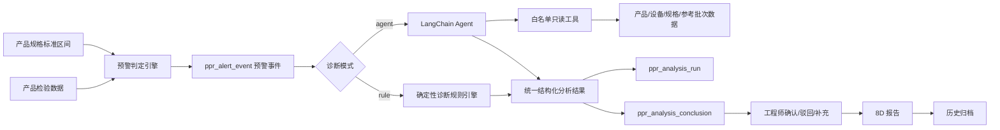
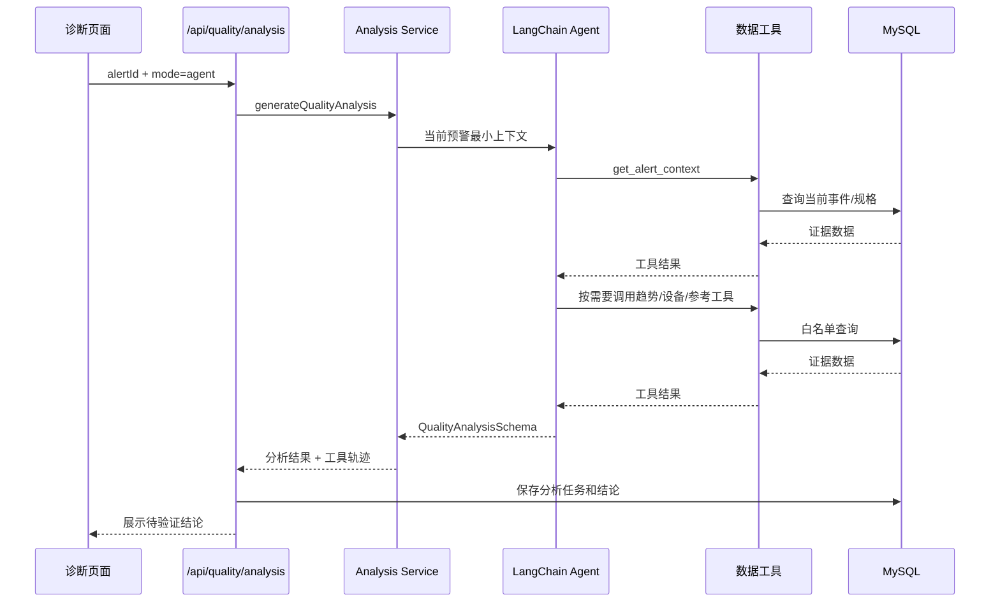

# 异常诊断 Agent 调用规则与分析逻辑

> 文档版本：V1.0  
> 适用模块：PPR 质量智能分析助手 / 异常诊断与验证  
> 实现框架：LangChain `createAgent` + LangGraph + `@langchain/openai`  
> 对应代码目录：`src/lib/quality-analysis/`

## 1. 文档目的

本文说明异常诊断模块中以下内容：

- 规则引擎与 Agent 两种分析模式如何选择；
- Agent 的输入、工具、系统约束和输出结构；
- 产品、设备、规格及历史数据如何参与分析；
- Agent 失败时如何降级；
- 分析过程如何入库、审计及交由工程师验证；
- DeepSeek 等 OpenAI 兼容模型的调用注意事项。

本文描述的是当前代码真实实现，不表示模型可以独立完成质量判定。系统中的 Agent 只负责生成**待工程师验证的分析线索**，不能代替正式标准、检验判定、质量审批或最终根因确认。

---

## 2. 总体架构



系统分为三个层次：

1. **预警判定层**：用确定性规则判断数据是否超出规格区间或接近边界；
2. **异常诊断层**：规则引擎或 Agent 根据预警事件形成分析线索；
3. **人工闭环层**：工程师验证分析结论，之后进入 8D 和历史归档。

预警判定和异常诊断是两个不同概念：

- 预警判定回答“哪条数据需要关注”；
- 异常诊断回答“应从哪些方向排查、当前有哪些证据、还缺什么证据”。

---

## 3. 分析入口

### 3.1 API

异常诊断通过以下接口生成：

```http
POST /api/quality/analysis
Content-Type: application/json
```

请求示例：

```json
{
  "alertId": 4,
  "mode": "agent",
  "regenerate": true,
  "generatedBy": "质量工程师"
}
```

字段说明：

| 字段 | 必填 | 说明 |
|---|---:|---|
| `alertId` | 是 | `ppr_alert_event.id`，本次诊断的预警事件 |
| `mode` | 否 | `rule` 或 `agent`；传入时覆盖系统默认模式 |
| `regenerate` | 否 | `false` 时复用该预警最新分析；`true` 时重新生成一条分析任务 |
| `generatedBy` | 否 | 分析发起人；未传时使用当前登录用户 |

### 3.2 前置校验

接口执行前依次检查：

1. 用户必须登录；
2. `alertId` 必须为有效数字；
3. 预警事件必须存在；
4. 如果已有分析且 `regenerate=false`，直接返回最新分析，不重复调用模型；
5. 只有需要新建分析时才进入规则或 Agent 编排。

---

## 4. 两种诊断模式

## 4.1 模式选择优先级

实际模式按以下顺序确定：

```text
本次请求 mode
    > system_config.quality_analysis_mode
    > 环境变量 QUALITY_ANALYSIS_MODE
    > rule
```

即：

- 诊断页面可以对单次分析选择模式；
- 管理员可以在“系统设置 → 质量 Agent”配置系统默认模式；
- 环境变量仅作为数据库没有配置项时的部署级默认值；
- 最终兜底为规则引擎。

## 4.2 规则引擎模式

规则模式特点：

- 不调用外部模型；
- 不需要 API Key；
- 可离线运行；
- 结果可重复、低延迟；
- 使用固定证据层次生成三类待验证结论。

当前固定分析层次：

1. **触发规则与限值对照**；
2. **同批次变化趋势观察**；
3. **同期设备因素观察**。

规则模式不会计算真正的因果关系，也不会把同期变化直接表述为根因。

实现文件：

```text
src/lib/quality-analysis/rule-engine.ts
```

## 4.3 LangChain Agent 模式

Agent 模式特点：

- 使用 LangChain `createAgent`；
- 模型根据预警内容自主决定调用哪些白名单工具；
- 工具返回真实数据库证据；
- 最终结果必须符合 Zod 结构化 Schema；
- 工具轨迹、模型、耗时、Token 和返回消息均写入数据库；
- Agent 结果仍必须由工程师验证。

实现文件：

```text
src/lib/quality-analysis/langchain-agent.ts
```

---

## 5. Agent 配置规则

配置读取实现：

```text
src/lib/quality-analysis/config.ts
```

### 5.1 主要配置

| 配置项 | 来源 | 说明 |
|---|---|---|
| `quality_analysis_mode` | `system_config` | 系统默认模式：`rule` / `agent` |
| `quality_agent_model` | `system_config` | 模型名称 |
| `quality_agent_fallback_to_rule` | `system_config` | Agent 失败时是否降级规则引擎 |
| `quality_agent_max_tool_rounds` | `system_config` | Agent 最大工具轮数，限制为 2～20 |
| `quality_agent_reasoning_effort` | `system_config` | OpenAI Responses API 推理强度 |
| `QUALITY_AGENT_API_KEY` | 环境变量 | Agent API Key，禁止写入数据库 |
| `QUALITY_AGENT_BASE_URL` | 环境变量 | OpenAI 或 OpenAI 兼容网关地址 |
| `QUALITY_AGENT_TIMEOUT_MS` | 环境变量 | 单次模型请求超时时间，限制为 10～300 秒 |
| `QUALITY_AGENT_USE_RESPONSES_API` | 环境变量 | 是否使用 OpenAI Responses API |
| `QUALITY_AGENT_THINKING_MODE` | 环境变量 | `auto` / `enabled` / `disabled` |

API Key 读取优先级：

```text
QUALITY_AGENT_API_KEY > OPENAI_API_KEY
```

Base URL 读取优先级：

```text
QUALITY_AGENT_BASE_URL > OPENAI_BASE_URL
```

模型读取优先级：

```text
system_config.quality_agent_model
    > QUALITY_AGENT_MODEL
    > gpt-6-luna
```

### 5.2 Agent 是否视为已配置

只要存在以下任一环境变量，状态接口就认为 Agent 已配置：

```text
QUALITY_AGENT_API_KEY
OPENAI_API_KEY
```

这只表示“密钥存在”，不表示密钥一定有效。真正有效性以模型调用结果为准。

### 5.3 状态接口

```http
GET /api/quality/agent/status
```

返回示例：

```json
{
  "mode": "agent",
  "configured": true,
  "model": "deepseek-v4-flash",
  "fallbackToRule": true,
  "framework": "LangChain createAgent",
  "useResponsesApi": false,
  "thinkingMode": "disabled"
}
```

---

## 6. Agent 输入上下文

Agent 启动前，后端会先用 `alertId` 查询最小必要上下文，包括：

- 预警事件编号；
- 触发规则及风险级别；
- 异常指标和观测值；
- 触发检验记录、样管、检验时间；
- 所属批次、生产组别、规格；
- 当前规格的外径、壁厚及不圆度区间；
- 当前记录中的外径、壁厚、不圆度数值；
- 数据来源。

最小上下文只用于限定 Agent 的数据边界。详细证据必须由 Agent 调用工具获取。

---

## 7. Agent 系统规则

当前 Prompt 版本：

```text
quality-agent-v1.0
```

Agent 版本：

```text
langchain-create-agent-v1
```

系统 Prompt 强制以下规则：

1. 必须首先调用 `get_alert_context`；
2. 根据需要调用产品趋势、同期设备、参考批次和指标定义工具；
3. 只能使用工具返回的数据，不得编造记录、数值、标准条款、设备状态或因果关系；
4. 必须区分观察事实、待验证假设、缺失证据和验证动作；
5. 同期变化不代表因果；
6. 演示限值不能表述为正式合格判定；
7. 工程师确认前不得宣称最终根因；
8. 每条结论必须列出证据来源编号；
9. 每条结论必须给出 0～1 的证据完备度；
10. 数据不足时必须明确说明不足，不能为了凑结论而猜测；
11. 输出语言为简洁、专业的中文。

特别说明：

> `confidence` 表示当前结论的证据完备程度，不表示“该因素是真实根因的概率”。

---

## 8. Agent 白名单工具

工具实现文件：

```text
src/lib/quality-analysis/data-tools.ts
```

Agent 不具备直接执行 SQL 的能力，不能提交表名、列名、任意业务 ID 或任意查询条件。所有查询范围由后端根据当前预警上下文闭包限定。

## 8.1 `get_alert_context`

用途：获取当前预警事件、检验记录、批次、规格及标准区间。

输入：

```json
{}
```

数据范围：

- 仅当前 `alertId`；
- 无法查询其他事件。

调用规则：必须首先调用。

## 8.2 `get_batch_measurements`

用途：获取当前批次、异常时刻之前的产品检验序列。

输入：

```json
{
  "limit": 10
}
```

限制：

- `limit` 最小 3，最大 30；
- 仅查询当前预警所属批次；
- 只查询 `inspect_time <= 当前异常时间` 的记录；
- 按检验时间倒序返回。

主要用于：

- 连续变化分析；
- 离散波动识别；
- 判断当前点是否缺少前序可比记录。

## 8.3 `get_equipment_window`

用途：获取异常时刻前后的设备采集数据。

输入：

```json
{
  "windowMinutes": 240
}
```

限制：

- 时间窗口最小 30 分钟，最大 1440 分钟；
- 仅查询当前批次；
- 设备数据按采集时间排序；
- 返回设备编号、名称、类型、温度、压力、牵引速度、来源及备注。

分析约束：

- 设备参数与产品指标同期变化只能作为相关线索；
- 不允许直接据此判定设备参数是根因。

## 8.4 `get_reference_measurements`

用途：获取相同产品规格的其他正常批次记录。

输入：

```json
{
  "limit": 15
}
```

限制：

- `limit` 最小 3，最大 50；
- 必须与当前产品规格相同；
- 排除当前批次；
- 只返回 `quality_flag='normal'` 的记录。

分析约束：

- 参考批次只用于观察对照；
- 参考范围不是正式规格限值或统计控制限。

## 8.5 `get_metric_definition`

用途：获取当前异常指标的定义、单位、通用提示和影响因素。

输入：

```json
{}
```

限制：

- 仅查询当前预警的 `metric_code`；
- 无法通过模型传入其他指标编码。

---

## 9. Agent 调用循环

Agent 使用：

```ts
createAgent({
  model,
  tools,
  systemPrompt,
  responseFormat: toolStrategy(QualityAnalysisSchema),
});
```

调用过程：



最大递归限制计算方式：

```text
recursionLimit = maxToolRounds × 2 + 4
```

例如最大工具轮数为 8 时：

```text
recursionLimit = 20
```

---

## 10. 模型调用参数

模型由 `ChatOpenAI` 初始化，关键参数包括：

```ts
new ChatOpenAI({
  model,
  apiKey,
  useResponsesApi,
  timeout,
  maxRetries: 2,
  reasoning,
  modelKwargs,
  configuration: { baseURL },
});
```

### 10.1 Responses API 模式

当：

```env
QUALITY_AGENT_USE_RESPONSES_API=true
```

系统可以传入：

```text
reasoning.effort = minimal / low / medium / high
```

当推理强度为 `none` 时，不发送 reasoning 参数。

### 10.2 OpenAI 兼容 Chat Completions 模式

当：

```env
QUALITY_AGENT_USE_RESPONSES_API=false
```

系统不发送 OpenAI Responses API 的 reasoning 参数。

### 10.3 DeepSeek Thinking 兼容规则

DeepSeek V4 等模型在 Thinking 模式下可能不支持结构化输出使用的强制 `tool_choice`。因此当前兼容配置为：

```env
QUALITY_AGENT_USE_RESPONSES_API=false
QUALITY_AGENT_REASONING_EFFORT=none
QUALITY_AGENT_THINKING_MODE=disabled
```

后端会附加：

```json
{
  "thinking": {
    "type": "disabled"
  }
}
```

这项设置关闭模型 Thinking 模式，但不会关闭 Agent 的工具调用流程。模型仍会通过 LangChain 调用数据工具并生成结构化结果。

---

## 11. 结构化输出规则

输出 Schema 定义：

```text
src/lib/quality-analysis/types.ts
```

完整结构：

```json
{
  "summary": "异常分析摘要",
  "riskAssessment": {
    "level": "medium",
    "reason": "风险说明"
  },
  "conclusions": [
    {
      "category": "同期设备因素",
      "hypothesis": "待工程师验证的假设",
      "evidence": "支持证据",
      "missingEvidence": "缺失证据",
      "validationAction": "建议验证动作",
      "confidence": 0.65,
      "evidenceSourceIds": [
        "IR-20261010-003",
        "ER-20261010-1000"
      ]
    }
  ],
  "analysisLimitations": [
    "当前分析限制"
  ]
}
```

Schema 限制：

| 字段 | 限制 |
|---|---|
| `summary` | 最少 20 个字符，必须说明事件、批次和分析边界 |
| `riskAssessment.level` | `normal` / `medium` / `high` / `error` |
| `conclusions` | 最少 2 条、最多 6 条 |
| `hypothesis` | 最少 10 个字符，必须是待验证假设 |
| `confidence` | 0～1 |
| `evidenceSourceIds` | 业务记录编号数组 |
| `analysisLimitations` | 至少 1 条 |

如果模型输出无法通过 Zod 校验，则本次 Agent 分析视为失败，并进入降级或报错流程。

---

## 12. 降级规则

编排入口：

```text
src/lib/quality-analysis/service.ts
```

### 12.1 直接使用规则引擎

当实际模式为：

```text
rule
```

系统不会初始化模型，也不会发送外部请求。

### 12.2 Agent 未配置

如果模式为 `agent`，但没有 API Key：

```text
Agent模式已启用，但未配置 QUALITY_AGENT_API_KEY 或 OPENAI_API_KEY
```

当 `quality_agent_fallback_to_rule=true` 时：

- 自动执行规则引擎；
- `engine_type` 保存为 `rule`；
- 降级原因写入 `fallback_reason`；
- 页面显示 Agent 降级提醒。

### 12.3 Agent 调用失败

以下情况均视为 Agent 失败：

- 网关无法连接；
- API Key 无效；
- 模型不存在或无权限；
- 调用超时；
- 工具调用超过递归限制；
- 模型不支持当前工具调用参数；
- 模型结果不符合结构化 Schema；
- LangChain 执行异常。

当允许降级时，保存格式为：

```text
fallback_reason = LangChain Agent调用失败：具体错误信息
```

### 12.4 禁止降级

当：

```text
quality_agent_fallback_to_rule=false
```

Agent 失败后接口直接返回错误，不生成规则分析结果。

---

## 13. 规则分析逻辑

规则模式读取：

- 当前预警和规格信息；
- 当前批次异常时间之前最多 5 条产品记录；
- 距离异常时间最近的最多 4 条设备记录。

### 13.1 限值对照

生成内容：

- 触发规则；
- 当前观测值；
- 阈值说明；
- 检验记录、样管、时间及数据来源；
- 原始记录、量具和正式标准的缺失说明。

默认证据完备度：

```text
0.95
```

### 13.2 趋势观察

计算过程：

1. 根据异常指标映射到产品数据列；
2. 提取最多 5 个有效数值；
3. 按时间正序排列；
4. 计算首点到末点的净变化；
5. 输出所有可比点作为证据。

证据完备度：

```text
有效点数 >= 3：0.80
有效点数 < 3：0.45
```

### 13.3 同期设备因素

展示内容：

- 设备采集时间；
- 设备名称；
- 温度；
- 压力；
- 牵引速度。

证据完备度：

```text
存在设备记录：0.55
无设备记录：0.20
```

规则模式同样声明：

- 没有计算因果关系；
- 规则参数和限值可能仍是演示配置；
- 最终根因和处置必须由工程师确认。

---

## 14. 分析结果入库

## 14.1 分析任务表 `ppr_analysis_run`

保存字段：

| 字段 | 内容 |
|---|---|
| `run_no` | 分析任务业务编号 |
| `alert_id` | 关联预警事件 |
| `summary` | 结构化结果中的分析摘要 |
| `evidence_snapshot` | 当前事件及工具证据快照 |
| `engine_type` | 实际执行的 `rule` 或 `agent` |
| `model_name` | Agent 实际模型 |
| `prompt_version` | Prompt 或规则模板版本 |
| `agent_version` | Agent 编排版本 |
| `tool_trace_json` | 工具调用输入、输出、时间和耗时 |
| `token_usage_json` | 输入、输出及总 Token |
| `raw_response_json` | 模型返回消息的审计快照 |
| `latency_ms` | 本次分析总耗时 |
| `fallback_reason` | Agent 降级原因 |
| `generated_by` | 发起人 |

## 14.2 结论表 `ppr_analysis_conclusion`

每条结论单独保存：

| 字段 | 内容 |
|---|---|
| `category` | 结论类别 |
| `hypothesis` | 待验证假设 |
| `evidence` | 支持证据 |
| `missing_evidence` | 缺失证据 |
| `validation_action` | 建议验证动作 |
| `confidence` | 证据完备度 |
| `evidence_source_ids` | 证据业务编号 |
| `generated_by_model` | 生成模型 |
| `engineer_decision` | `pending` / `confirmed` / `rejected` |
| `engineer_comment` | 工程师意见 |
| `actual_finding` | 现场验证发现 |
| `engineer_modified` | 工程师是否修改或补充 |

生成分析后，预警状态更新为：

```text
analyzing
```

---

## 15. 工程师验证规则

Agent 或规则引擎生成的结论初始状态均为：

```text
pending
```

工程师可以：

- 确认：`confirmed`；
- 驳回：`rejected`；
- 暂存：保持 `pending`；
- 填写实际发现；
- 填写工程师意见。

保存工程师操作后：

```text
engineer_modified = 1
```

当同一分析任务不存在待验证结论时：

```text
ppr_analysis_run.status = completed
```

否则状态为：

```text
reviewing
```

8D 报告只应继承工程师已经确认的结论，不能直接把未经确认的 Agent 假设当成最终根因。

---

## 16. 安全与数据边界

### 16.1 API Key

- 只存储在 `.env.local` 或部署环境变量；
- `.env.local` 已被 Git 忽略；
- 不保存到 `system_config`；
- 不返回给前端；
- 不写入 Agent 工具轨迹。

### 16.2 数据库权限

Agent 本身不能访问数据库连接对象，所有查询必须通过预定义工具。

工具不接受：

- 表名；
- SQL；
- 任意字段名；
- 任意批次 ID；
- 任意规格 ID；
- 任意指标编码。

### 16.3 业务边界

Agent 不负责：

- 正式产品合格判定；
- 自动放行或报废；
- 自动关闭预警；
- 自动确认根因；
- 自动定稿 8D；
- 修改产品、设备或批次数据。

---

## 17. 代码文件对应关系

| 文件 | 职责 |
|---|---|
| `src/lib/quality-analysis/config.ts` | 分析模式、模型、网关及降级配置 |
| `src/lib/quality-analysis/data-tools.ts` | Agent 白名单数据工具 |
| `src/lib/quality-analysis/langchain-agent.ts` | LangChain Agent、Prompt、模型调用和结果审计 |
| `src/lib/quality-analysis/rule-engine.ts` | 确定性规则诊断 |
| `src/lib/quality-analysis/service.ts` | 双模式选择和自动降级 |
| `src/lib/quality-analysis/types.ts` | Zod 结构化输出和公共类型 |
| `src/lib/quality-analysis/alert-engine.ts` | 产品数据预警判定，不属于大模型诊断 |
| `src/app/api/quality/analysis/route.ts` | 分析查询、生成、持久化和工程师验证 API |
| `src/app/api/quality/agent/status/route.ts` | Agent 配置状态 API |
| `src/components/quality/DiagnosisClient.tsx` | 诊断模式选择、结果展示和工程师验证 UI |
| `scripts/migrations/001_quality_agent.sql` | Agent 审计字段及系统配置迁移 |

---

## 18. 扩展建议

后续扩展时建议遵守以下原则：

1. 新数据源通过新工具接入，不允许开放任意 SQL；
2. 工具返回必须包含稳定业务编号，便于证据追溯；
3. 修改 Prompt 时同步升级 `PROMPT_VERSION`；
4. 修改 Agent 编排时同步升级 `AGENT_VERSION`；
5. 修改输出字段时先更新 Zod Schema，再更新数据库迁移和前端；
6. 新增知识库时区分正式标准、企业 SOP 和历史案例；
7. 历史案例只能作为参考，不能自动替代当前批次验证；
8. 对模型输出建立离线评测集，重点检查幻觉、证据引用、缺失证据识别和验证动作可执行性；
9. 正式上线前对 Token、延迟、失败率和降级率建立监控；
10. 涉及写操作的工具必须增加人工确认，不应复用当前只读工具策略直接放开。

---

## 19. 验证清单

每次修改 Agent 后至少检查：

```text
[ ] 规则模式不调用外部模型
[ ] Agent 模式首先调用 get_alert_context
[ ] Agent 不能查询当前预警之外的任意批次
[ ] 工具调用轨迹能够正常入库
[ ] 结论数量保持在 2～6 条
[ ] 每条结论包含证据、缺失证据和验证动作
[ ] confidence 在 0～1 范围
[ ] evidenceSourceIds 能对应真实业务记录
[ ] Agent 失败时按照配置降级
[ ] fallback_reason 能准确记录失败原因
[ ] 工程师确认和驳回功能正常
[ ] 8D 只继承已确认结论
[ ] API Key 未出现在前端、日志或数据库
[ ] TypeScript、ESLint 和生产构建通过
```

推荐执行：

```bash
pnpm ts-check
pnpm lint:build
pnpm build
```
