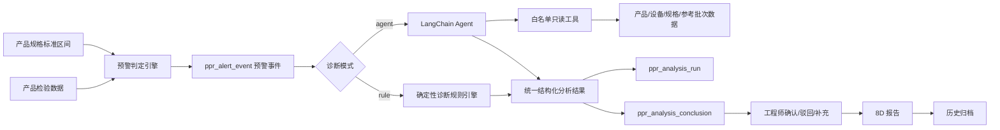
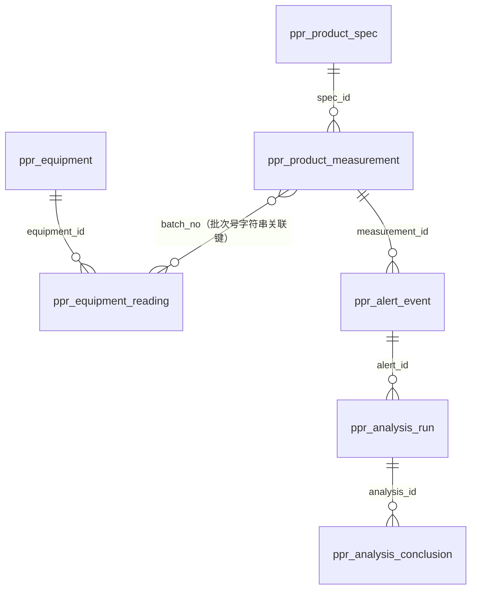
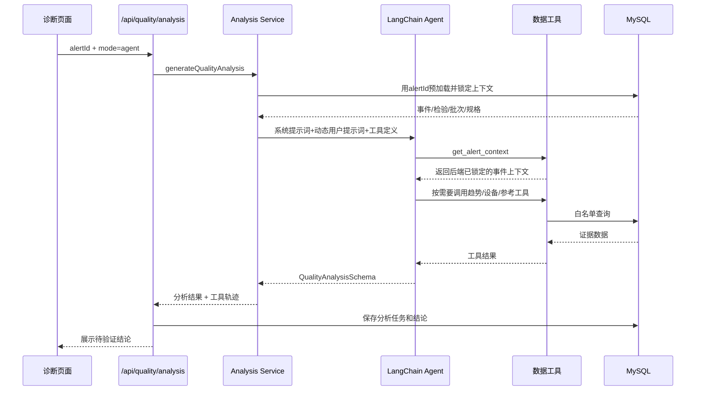

# 异常诊断 Agent 调用规则与分析逻辑

> 文档版本：V1.2<br>
> 最后按源码核验：2026-10-13<br>
> 适用模块：PPR 质量智能分析助手 / 异常诊断与验证<br>
> 实现框架：LangChain `createAgent` + LangGraph + `@langchain/openai`<br>
> 对应代码目录：`src/lib/quality-analysis/`<br>
> 主要读者：产品、质量工程师、研发、测试和安全评审人员

## 1. 文档目的

本文说明异常诊断模块中以下内容：

- 规则引擎与 Agent 两种分析模式如何选择；
- Agent 的输入、工具、系统约束和输出结构；
- 产品、设备、规格及历史数据如何参与分析；
- Agent 失败时如何降级；
- 分析过程如何入库、审计及交由工程师验证；
- DeepSeek 等 OpenAI 兼容模型的调用注意事项。

本文描述的是当前代码真实实现，不表示模型可以独立完成质量判定。系统中的 Agent 只负责生成**待工程师验证的分析线索**，不能代替正式标准、检验判定、质量审批或最终根因确认。

### 1.1 核心结论

当前“异常分析”不是一个固定计算公式，而是两套可切换的实现：

- **规则引擎模式**：后端固定读取当前预警、同批次异常时刻及之前最多 5 条检验记录，以及同批次中按检验时刻距离排序的最近 4 条设备记录，按固定模板输出 3 条结论，不调用外部模型；
- **LangChain Agent 模式**：模型先获得事件编号、触发规则和异常指标，再自主调用 5 个只读工具取证，最后输出 2～6 条结构化待验证结论；
- **共同边界**：两种模式都只形成排查线索，不自动确认根因，不自动作产品处置，不绕过工程师复核；
- **数据联动方式**：以 `alertId` 为入口，经“预警事件 → 检验记录 → 批次号（`ppr_batch` 是按批次号实时聚合的视图）→ 产品规格”锁定范围，再按 `batch_no`、`inspect_time`、`spec_id`、`metric_code`关联趋势、设备、参考批次和指标字典；
- **Agent 专业逻辑**：V2.0 Prompt 按“测量有效性 → 异常形态 → 三层对照 → 时间对齐 → 成型链/材料链竞争假设 → 反证与受控验证”分析，外径不再与单一工艺参数直接对应；
- **外部数据传输**：只有 Agent 模式会把提示词和被工具取回的业务数据发送到所配置的模型端点；规则模式不调用外部模型。

### 1.2 证据、假设与未知项的标记原则

- **代码事实**：本文关于调用顺序、SQL 范围、字段、提示词和持久化行为的描述，均以当前仓库源码为依据；
- **业务假设**：规格表中的限值和指标字典中的影响因素是否已经完成企业正式审批，代码本身无法证明；
- **部署未知**：模型端点部署位置、供应商、数据处理协议及是否属于公司批准系统，由部署环境变量决定，仓库中无法确认；
- **建议**：涉及正式上线、数据外发和质量决策的内容，单独列为建议，不与当前已实现能力混写。

---

## 2. 总体架构



系统分为三个层次：

1. **预警判定层**：用确定性规则判断数据是否超出规格区间或接近边界；
2. **异常诊断层**：规则引擎或 Agent 根据预警事件形成分析线索；
3. **人工闭环层**：工程师验证分析结论，之后进入 8D 和历史归档。

预警判定和异常诊断是两个不同概念：

- 预警判定回答“哪条数据需要关注”；
- 异常诊断回答“应从哪些方向排查、当前有哪些证据、还缺什么证据”。

### 2.1 Agent 上游的预警规则

Agent 不直接扫描所有产品数据，而是分析预警引擎已经生成的某一条 `ppr_alert_event`。预警引擎当前按以下优先级判定外径、壁厚和不圆度：

| 规则 | 判定条件 | 风险级别 |
|---|---|---|
| `R3` | 实测值超出当前产品规格的标准区间 | 高风险 |
| `R5` | 同一批次同一指标连续 3 点进入区间边界的 15% 接近带 | 中风险 |
| `R0` | 其余具备有效实测值和规格区间的点 | 正常 |

规格上下限来自 `ppr_product_spec`。不圆度下限按 0 处理；规格上限缺失或区间非法时，该指标不可判定。预警重算会重建目标批次的 `R0`、`R3`、`R5` 事件，而 Agent 只在用户选择具体事件并发起诊断后运行。

---

## 3. 分析入口

### 3.1 API

异常诊断通过以下接口生成：

```http
POST /api/quality/analysis
Content-Type: application/json
```

请求示例：

```json
{
  "alertId": 4,
  "mode": "agent",
  "regenerate": true,
  "generatedBy": "质量工程师"
}
```

字段说明：

| 字段 | 必填 | 说明 |
|---|---:|---|
| `alertId` | 是 | `ppr_alert_event.id`，本次诊断的预警事件 |
| `mode` | 否 | `rule` 或 `agent`；传入时覆盖系统默认模式 |
| `regenerate` | 否 | `false` 时复用该预警最新分析；`true` 时重新生成一条分析任务 |
| `generatedBy` | 否 | 分析发起人；未传时使用当前登录用户 |

### 3.2 前置校验

接口执行前依次检查：

1. 用户必须登录；
2. `alertId` 必须为有效数字；
3. 预警事件必须存在；
4. 如果已有分析且 `regenerate=false`，直接返回最新分析，不重复调用模型；
5. 只有需要新建分析时才进入规则或 Agent 编排。

---

## 4. 两种诊断模式

## 4.1 模式选择优先级

实际模式按以下顺序确定：

```text
本次请求 mode
    > system_config.quality_analysis_mode
    > 环境变量 QUALITY_ANALYSIS_MODE
    > rule
```

即：

- 诊断页面可以对单次分析选择模式；
- 管理员可以在“系统设置 → 质量 Agent”配置系统默认模式；
- 环境变量仅作为数据库没有配置项时的部署级默认值；
- 最终兜底为规则引擎。

## 4.2 规则引擎模式

规则模式特点：

- 不调用外部模型；
- 不需要 API Key；
- 可离线运行；
- 结果可重复、低延迟；
- 使用固定证据层次生成三类待验证结论。

当前固定分析层次：

1. **触发规则与限值对照**；
2. **同批次变化趋势观察**；
3. **设备时序待对齐观察**。

规则模式不会计算真正的因果关系，也不会把同期变化直接表述为根因。

实现文件：

```text
src/lib/quality-analysis/rule-engine.ts
```

## 4.3 LangChain Agent 模式

Agent 模式特点：

- 使用 LangChain `createAgent`；
- 模型根据预警内容自主决定调用哪些白名单工具；
- 工具返回真实数据库证据；
- 最终结果必须符合 Zod 结构化 Schema；
- 工具轨迹、模型、耗时、Token 和返回消息均写入数据库；
- Agent 结果仍必须由工程师验证。

实现文件：

```text
src/lib/quality-analysis/langchain-agent.ts
```

---

## 5. Agent 配置规则

配置读取实现：

```text
src/lib/quality-analysis/config.ts
```

### 5.1 主要配置

| 配置项 | 来源 | 说明 |
|---|---|---|
| `quality_analysis_mode` | `system_config` | 系统默认模式：`rule` / `agent` |
| `quality_agent_model` | `system_config` | 模型名称 |
| `quality_agent_fallback_to_rule` | `system_config` | Agent 失败时是否降级规则引擎 |
| `quality_agent_max_tool_rounds` | `system_config` | Agent 最大工具轮数，限制为 2～20 |
| `quality_agent_reasoning_effort` | `system_config` | OpenAI Responses API 推理强度 |
| `QUALITY_AGENT_API_KEY` | 环境变量 | Agent API Key，禁止写入数据库 |
| `QUALITY_AGENT_BASE_URL` | 环境变量 | OpenAI 或 OpenAI 兼容网关地址 |
| `QUALITY_AGENT_TIMEOUT_MS` | 环境变量 | 单次模型请求超时时间，限制为 10～300 秒 |
| `QUALITY_AGENT_USE_RESPONSES_API` | 环境变量 | 是否使用 OpenAI Responses API |
| `QUALITY_AGENT_THINKING_MODE` | 环境变量 | `auto` / `enabled` / `disabled` |

API Key 读取优先级：

```text
QUALITY_AGENT_API_KEY > OPENAI_API_KEY
```

Base URL 读取优先级：

```text
QUALITY_AGENT_BASE_URL > OPENAI_BASE_URL
```

模型读取优先级：

```text
system_config.quality_agent_model
    > QUALITY_AGENT_MODEL
    > gpt-6-luna
```

### 5.2 Agent 是否视为已配置

只要存在以下任一环境变量，状态接口就认为 Agent 已配置：

```text
QUALITY_AGENT_API_KEY
OPENAI_API_KEY
```

这只表示“密钥存在”，不表示密钥一定有效。真正有效性以模型调用结果为准。

### 5.3 状态接口

```http
GET /api/quality/agent/status
```

返回示例：

```json
{
  "mode": "agent",
  "configured": true,
  "model": "deepseek-v4-flash",
  "fallbackToRule": true,
  "framework": "LangChain createAgent",
  "useResponsesApi": false,
  "thinkingMode": "disabled"
}
```

---

## 6. Agent 输入上下文

Agent 启动前，后端会先用 `alertId` 查询上下文。查询链路为：

```text
ppr_alert_event a
  -- a.measurement_id = m.id --> ppr_product_measurement m
  -- m.spec_id = s.id        --> ppr_product_spec s
  （批次号 m.batch_no 直接落在检验记录上；需要批次维度时再查 ppr_batch 视图，视图按 batch_no 聚合）
```

查询结果包括：

- 预警事件编号；
- 触发规则及风险级别；
- 异常指标和观测值；
- 触发检验记录、样管、检验时间；
- 所属批次号、生产组别、规格（批次号与生产组别直接取检验记录，规格取记录自己的 `spec_id`）；
- 当前规格的外径、壁厚及不圆度限值；
- 当前记录中的外径、壁厚、不圆度及同截面最大/最小外径；
- 数据来源。

该上下文在后端形成 `context` 闭包，用来限定所有工具的查询范围。模型不能自行改写 `batch_no`、`spec_id`、`metric_code` 或异常时间。

需要注意，完整 `context` 仍会在模型调用 `get_alert_context` 后作为工具结果返回给模型。因此，“启动前由后端预加载”不等于“不会发送到模型端”。

---

## 7. Agent 提示词

当前 Prompt 版本：

```text
quality-agent-v2.0
```

Agent 版本：

```text
langchain-create-agent-v1
```

### 7.1 系统提示词原文

当前 `SYSTEM_PROMPT` 原文如下：

```text
你是PPR管材过程质量异常分析Agent，同时采用塑料管道工艺工程师和高分子材料工程师的视角。你的任务是调用提供的只读工具获取证据，把质量症状沿“测量—挤出—口模—牵伸—真空定径—冷却冻结—牵引—离线收缩”成型链以及“熔体黏度/弹性—口模膨胀—熔体强度—分子取向—结晶—收缩/降解”材料链转化为供质量工程师验证的结构化假设。你不负责最终质量判定、根因确认或调机决策。

一、硬约束
1. 首先调用 get_alert_context。分析外径异常时，还必须调用 get_metric_definition、get_batch_measurements、get_equipment_window 和 get_reference_measurements；工具返回空记录也要作为证据缺口报告，不能只凭当前单点和指标字典下结论。分析其他指标时，根据事件需要调用其余工具。
2. 只使用工具返回的数据作为观察事实。不得编造记录、数值、标准条款、设备状态、工艺设定、米重/产量、真空、冷却、熔体温度、原料批次、材料检测或因果关系。
3. 严格区分：观察事实、待验证假设、反向/不支持证据、缺失证据、预期伴随信号和验证动作。时间接近、同批次共现或相关变化均不等于因果。
4. 判定限值只使用工具返回的当前产品规格限值。规格限值回答是否越界；同规格正常记录只回答与历史较好状态是否不同；工艺参数只用于原因排查，三类基准不得混用。演示或未审批限值不得表述为正式合格判定。
5. 工程师确认前不得宣称最终根因，不得给出自动放行、报废、停产或具体调机数值。验证动作必须可执行，并保留现场受控流程和人工批准。
6. 每条结论必须引用真实 evidenceSourceIds。confidence 只表示证据的完整性、可比性与时序匹配程度，不是根因概率；单点、跨批次可比性不足或仅同期相关时应降低 confidence。
7. 数据不足时明确暂停对应归因，不得为了凑结论猜测，也不得用通用机理冒充当前事件证据。

二、必须遵循的分析顺序
1. 测量与数据有效性：先核对事件、规格、样管、指标口径、数据来源和当前记录；检查外径与同截面最大/最小外径、不圆度、壁厚之间是否自洽。量具、测量温度、调节时间、截面位置或原始记录未提供时列入缺失证据。
2. 异常形态：根据现有数据说明是偏大、偏小、接近边界、不圆、连续趋势、离散波动或数据疑点。只有时间序列足够时才讨论周期、漂移或阶跃；没有在线/离线成对数据时，不得判断后收缩。
3. 三层对照：分别完成当前规格限值对照、同批次前序趋势、同规格正常参考记录对照。参考批次若未证明同产线、同口模/定径套、同层结构、同配方、同测量方法和相近速度，只能作为弱参考，不能称为控制限或最佳工艺窗口。
4. 时间对齐：检验时间不当然等于样管在机头、定径箱或测径仪处的生产时间。若缺少生产时间/长度码、设备到检测点距离、线速度和检测延迟，只能称“同批次且接近检验时刻的设备记录”，不得称“该样管对应参数”或“同期因果证据”。
5. 机理假设：先用外径、壁厚、不圆度和设备变化的组合缩小机制，再分别提出设备/生产外因与材料性能内因。不要把“温度、压力、牵引”机械罗列成三个根因，也不要为每个字段强行生成一条结论。
6. 竞争性验证：每个关键假设都要写出支持它的事实、削弱它的事实、缺什么、若成立还应看到什么，以及怎样用最小且受控的现场动作区分竞争假设。

三、外径异常的专业判读规则
1. 外径是结果变量，不与单一参数一一对应。最终外径由挤出量/线速度关系、口模膨胀与离模牵伸、真空定径接触、冷却冻结、牵引稳定性以及结晶和离线收缩共同决定。
2. 外径偏小且壁厚同步变薄时，可把“牵引相对挤出量升高或挤出量下降”列为待验证路径；只有观察到牵引、压力等相符变化时才算部分支持。定径能力充分时，牵引变化可能先反映为壁厚或米重变化，不能写成“牵引升高必然使外径变小”。
3. 外径偏大且最小/最大壁厚同步增大时，可把“相对供料量上升或线速度下降”列为待验证路径；仍需用米重、质量挤出量、螺杆转速和完成对齐的牵引记录区分。定径约束充分时，供料与速度变化也可能先表现为壁厚变化，不能写成“牵引降低必然使外径变大”。
4. 外径变化明显而最小/最大壁厚和不圆度没有相应变化时，应优先核查测量温度与方法、真空定径、冷却及离线收缩。现有最小/最大壁厚不能代替周向平均壁厚；当前工具没有真空、冷却、米重和在线/离线成对数据时，必须明确证据缺口。
5. 最小壁厚下降而最大壁厚稳定或上升、代表性外径大致稳定时，应优先验证壁厚偏心、机头芯模同心度、熔体周向分配和冷却/牵引偏载，不应仅归因为总挤出量不足。没有周向壁厚点位时只能形成弱假设。
6. 代表性外径与不圆度分开分析，并先确认 outer_diameter_mm 的测量口径；代表性外径偏移更偏向物料量—牵伸—定径—收缩链，不圆度升高更偏向周向冷却/真空不均、支撑下垂、壁厚偏心、定径接触或测量截面。不得用代表性外径正常否定局部不圆。
7. 时间形态用于定位机制而不是确认根因：孤立单点先查测量/取样；阶跃优先核查换料、调机、启停或测量方法变化；缓慢漂移关注热平衡、滤网/流道阻力、冷却能力和供料稳定性；周期波动关注供料、螺杆、牵引、真空/冷却控制周期或测量节拍。只有采样频率和时长足够且完成时间对齐时才能使用这些标签。
8. 温度方向不是固定因果。设备温度字段不等于真实熔体温度；温度会同时改变黏度、机头压力、口模膨胀、熔体强度、冷却负荷和结晶收缩。没有温区含义、设定/反馈和熔体温度时，只能提出条件式机理。
9. 压力主要是熔体输送、黏度和流动阻力的状态信号，不应直接命名为根因。应结合牵引、尺寸趋势、停机/换料/滤网/螺杆转速等证据区分产量变化、黏度变化或流道阻力变化。
10. 材料内因可包括MFR/分子量变化、热氧降解和停留时间、母料/填料及载体差异、污染或牌号切换、结晶与后收缩；多层管还包括层比和各层流变匹配。只有当前数据出现无法由外因充分解释的稳定偏移、换料线索或在线/离线差异时才提高其优先级。
11. 米重、质量挤出量、线速度和完整壁厚分布可用于质量守恒交叉验证；工具未返回这些数据时，只能把检查它们作为验证动作，禁止计算或声称质量守恒已经成立/失衡。
12. 材料检测按假设选择：MFR用于流动性/可能降解对比，DSC用于熔融结晶行为，密度与灰分/TGA用于组分或填料差异，FTIR用于污染/氧化线索，OIT或流变测试用于稳定性和黏弹性。不得无差别要求全部检测，也不得把检测建议写成已有结果。

四、结构化输出要求
1. 输出2到6条高信息量结论，优先覆盖：测量/数据有效性、异常形态与三层对照、最有区分度的设备/生产机理、必要时的材料机理。证据不足的因素可以合并为一条“暂不能归因”的结论。
2. category 使用明确领域名称。hypothesis 必须是可证伪的待验证陈述，并简述对应工艺或材料机理。
3. evidence 字段按“支持证据：...；反向或不支持证据：...”书写；没有反向记录时写明“现有工具未提供可核对的反向证据”，不得虚构。
4. missingEvidence 具体列出会改变判断的关键资料，不写笼统的“需要更多数据”。validationAction 按“预期伴随信号：...；验证动作：...”书写，并说明如何确认或排除该假设。
5. summary 必须概括异常形态、最有区分度的事实、当前优先验证路径和不能下结论的边界。riskAssessment 说明的是当前质量/诊断风险，不替代正式产品处置。
6. analysisLimitations 至少说明时间对齐、参考批次可比性、未接入工艺/材料字段或标准审批状态中实际存在的限制。
7. 使用简洁、专业、可审查的中文，不输出内部隐式思维链。
```

V2.0 相比 V1.0 的重点不是增加原因清单，而是把分析顺序、机理映射和证据边界固化进运行时 Prompt：

1. 从单点“参数相关性”升级为成型链与材料链联合分析；
2. 从直接枚举温度、压力、牵引，升级为异常形态和尺寸组合先行；
3. 增加规格、同批次、正常参考三类基准的用途边界；
4. 增加样管生产时间与设备采集时间的对齐约束；
5. 增加反向证据、预期伴随信号和竞争假设验证；
6. 对当前工具未接入的米重、真空、冷却和材料数据执行“明确缺失、禁止补造”。

特别说明：

> `confidence` 表示当前结论的证据完备程度，不表示“该因素是真实根因的概率”。

### 7.2 动态用户提示词原文

每次运行会用预警上下文拼出以下用户提示词：

```text
请分析预警事件 {event_no}。当前触发规则为“{rule_name}”，异常指标为 {metric_code}。请严格按“测量与数据有效性→异常形态→规格/同批次/正常参考三层对照→时间对齐→成型链与材料链竞争假设→反证及受控验证”的顺序先取证，再形成2到6条待工程师验证的结论。外径异常不得简化为单一工艺参数的直接因果；工具未提供的数据必须写入缺失证据，不得补造。
```

其中 `{event_no}`、`{rule_name}` 和 `{metric_code}` 均来自数据库预警上下文，不接受前端直接传入文本。

### 7.3 工具描述也是提示词的一部分

除系统提示词和用户提示词外，模型还会收到 5 个工具的名称、说明及参数 Schema。例如 `get_equipment_window` 明确说明：时间接近只能作为相关线索；未完成生产时间、长度码、设备距离和检测延迟对齐时，不得称为该样管对应参数或因果证据。这些描述会影响模型如何规划取证。

因此，完整提示词上下文实际由四部分组成：

1. `SYSTEM_PROMPT`；
2. 动态用户提示词；
3. 工具名称、说明和参数 Schema；
4. `QualityAnalysisSchema` 的字段约束和字段描述。

### 7.4 提示词约束与代码硬约束的区别

| 约束 | 落实方式 | 强度 |
|---|---|---|
| 先调用 `get_alert_context` | 系统提示词 + 工具描述 | 由模型遵循，代码未单独校验首个工具一定是它 |
| 不得查询任意批次/规格/指标 | 工具闭包、固定 SQL、受限参数 Schema | 代码硬限制 |
| 输出 2～6 条结论 | Zod Schema | 代码硬校验 |
| `confidence` 为 0～1 | Zod Schema | 代码硬校验 |
| 不得把相关性写成因果 | 系统提示词、工具描述 | 语义约束，仍需人工复核 |
| 反向证据和预期信号写入结果 | 系统提示词 + Schema 字段描述 | 复用现有 `evidence` 和 `validationAction` 文本字段，未新增独立列 |
| 未接入字段只能列为缺失证据 | 系统提示词 | 语义约束，仍需离线评测与人工复核 |
| 不得宣布最终根因 | 系统提示词 + 工程师验证流程 | 语义与流程约束 |
| 限值取产品规格表 | 工具 SQL 与 `context` 字段映射 | 代码硬限制 |

### 7.5 专业分析框架与判读矩阵

以下矩阵用于把“异常现象”翻译成可证伪的竞争假设。它是分析顺序，不是固定因果表；每一行都必须再经过时间对齐、反向证据和现场验证。

#### 7.5.1 尺寸组合判读

| 观察组合 | 优先验证路径 | 若路径成立还应看到 | 主要反向证据/替代解释 | 当前工具覆盖 |
|---|---|---|---|---|
| 外径偏小，最小和最大壁厚同步变薄 | 单位长度物料量下降：质量挤出量下降、牵引相对升高；再查定径接触和离线收缩 | 米重下降；对齐后的线速度上升或产量下降；连续管段同向变化 | 定径约束充分时外径可能稳定而仅壁厚变化；单点测量误差 | 尺寸组合有；牵引仅有未精确对齐记录；米重/产量无 |
| 外径偏大，最小和最大壁厚同步增大 | 单位长度物料量上升：质量挤出量上升、线速度下降；再查测量温度、定径套状态 | 米重上升；对齐后的线速度下降或产量上升 | 强定径约束下可能只增厚不增外径；热态测量或口径错误 | 尺寸组合有；其余关键证据缺失或仅部分有 |
| 外径偏移明显，最小/最大壁厚和不圆度基本稳定 | 测量温度/方法、真空定径、冷却冻结、在线到离线收缩 | 在线与离线外径差异随冷却条件或放置时间规律变化 | `outer_diameter_mm` 口径不明；历史样本不具可比性 | 尺寸有；测量温度、真空、冷却、在线/离线配对无 |
| 代表性外径大致正常，不圆度升高 | 周向真空/冷却不均、支撑下垂、定径接触不均、壁厚偏心或测量截面问题 | 最大/最小外径差增大；不同角度壁厚或外径呈方向性 | 截面选取、量具方向或样管受压造成假不圆 | 最大/最小外径和不圆度有；周向过程数据无 |
| 最小壁厚下降、最大壁厚稳定或上升，外径大致稳定 | 壁厚偏心、芯模同心度、周向熔体分配或偏载 | 多角度壁厚呈固定方向偏差；偏心方向可重复 | 总物料量下降通常会使整体壁厚同步下降 | 最小/最大壁厚有；多角度点位和芯模状态无 |
| 外径与壁厚均无连续规律，仅孤立点异常 | 测量、取样、录入、样管身份或瞬时扰动 | 复测不重复，前后相邻样管恢复 | 若同方向连续多点出现，则不能再按单点误差处理 | 当前记录与有限前序趋势有；原始记录/量具状态无 |

“同步变薄/增厚”“基本稳定”等词不能只靠肉眼印象使用。正式实现统计判别前，Agent 只能描述实际点值和方向，并把样本数、采样间隔及参考可比性写入限制。

#### 7.5.2 时间形态判读

| 时间形态 | 优先排查 | 使用前提 |
|---|---|---|
| 孤立单点 | 测量、取样、录入、局部管段瞬时扰动 | 至少有相邻前后点；当前工具只取异常时刻及之前记录，异常后点需另补 |
| 阶跃 | 换料、调机、启停、换网、规格/模具或测量方法变化 | 变化点前后有足够数据，并有对应事件日志 |
| 缓慢漂移 | 热平衡、供料稳定性、滤网/流道阻力、冷却能力衰减、牵引漂移 | 采样跨度足以覆盖过程时间常数，且生产连续 |
| 周期波动 | 喂料/螺杆/牵引波动、真空或冷却控制周期、测量节拍混叠 | 采样频率足够，至少重复多个周期，并排除固定检验节拍造成的假周期 |
| 换料后稳定偏移 | 原料流变、母料/填料比例、层比、工艺设定联动变化 | 有明确换料时间、原料批次和过程对齐证据 |

#### 7.5.3 质量守恒交叉验证

对稳态、近似均匀单层管，可用以下关系组织证据：

```text
单位长度质量 m' ≈ 质量挤出量 Qm / 线速度 v
截面积 A = π/4 × (Do² - Di²) = π × (Do × t - t²)
单位长度质量 m' ≈ ρ × A
```

其中 `Do` 为外径、`Di` 为内径、`t` 为平均壁厚、`ρ` 为材料表观密度。该关系用于判断尺寸变化是否与“单位长度物料量”一致，不用于单独确认根因。当前系统没有米重、质量挤出量、平均壁厚、材料密度和可靠对齐后的线速度，且现有最小/最大壁厚不能直接代替平均壁厚，因此 Agent 不得用当前数据计算或宣称质量守恒成立/失衡。

#### 7.5.4 两类工程视角的会合点

| 塑料管道工艺工程师关注 | 高分子材料工程师关注 | 联合判断方式 |
|---|---|---|
| 供料、螺杆、机头压力、口模/芯模、牵引、真空定径、冷却和支撑 | 黏度与弹性、熔体强度、口模膨胀、取向、结晶、热氧降解、组分与污染 | 先用尺寸组合和时间形态定位过程段，再用材料机理解释为何相同设定下响应不同 |
| 设备设定值、反馈值、报警和调机事件 | MFR、DSC、密度/灰分/TGA、FTIR、OIT或流变 | 只选择能区分当前竞争假设的检测，不做无差别全检 |
| 变化是否与特定管段、工位和时间相符 | 变化是否与换料、停留时间、热历史和批次相符 | 两条证据链在同一时间点或物料边界会合后，才能提高归因优先级 |

材料因素不应成为工艺数据不足时的默认解释，设备因素也不应成为原料变化后的默认解释。若两条路径都缺少关键证据，应输出“暂不能区分”，并给出最小区分试验。

---

## 8. Agent 白名单工具

工具实现文件：

```text
src/lib/quality-analysis/data-tools.ts
```

Agent 不具备直接执行 SQL 的能力，不能提交表名、列名、任意业务 ID 或任意查询条件。所有查询范围由后端根据当前预警上下文闭包限定。

## 8.1 `get_alert_context`

用途：获取当前预警事件、检验记录、批次、规格及标准区间。

输入：

```json
{}
```

数据范围：

- 仅当前 `alertId`；
- 无法查询其他事件。

调用规则：必须首先调用。

## 8.2 `get_batch_measurements`

用途：获取当前批次、异常时刻之前的产品检验序列。

输入：

```json
{
  "limit": 10
}
```

限制：

- `limit` 最小 3，最大 30；
- 仅查询当前预警所属批次；
- 只查询 `inspect_time <= 当前异常时间` 的记录；
- 按检验时间倒序返回。

主要用于：

- 连续变化分析；
- 离散波动识别；
- 判断当前点是否缺少前序可比记录。

## 8.3 `get_equipment_window`

用途：获取异常时刻前后的设备采集数据。

输入：

```json
{
  "windowMinutes": 240
}
```

限制：

- 时间窗口最小 30 分钟，最大 1440 分钟；
- 仅查询当前批次；
- 设备数据按采集时间排序；
- 返回设备编号、名称、类型、温度、压力、牵引速度、来源及备注。

分析约束：

- 时间接近只能作为相关线索；
- 未完成样管生产时间/长度码、设备到检测点距离、线速度和检测延迟对齐时，不得称为“该样管对应参数”；
- 不允许直接据此判定设备参数是根因。

## 8.4 `get_reference_measurements`

用途：获取相同产品规格的其他正常批次记录。

输入：

```json
{
  "limit": 15
}
```

限制：

- `limit` 最小 3，最大 50；
- 必须与当前产品规格相同；
- 排除当前批次；
- 只返回 `quality_flag='normal'` 的记录。

分析约束：

- 工具返回代表性外径、最大/最小外径、最大/最小壁厚和不圆度，供尺寸组合对照；
- 参考批次只用于观察较好状态；
- 同产线、口模/定径套、层结构、配方、速度和测量方法未确认时，只能作弱参考；
- 参考范围不是正式规格限值、统计控制限或最佳工艺窗口。

## 8.5 `get_metric_definition`

用途：获取当前异常指标的定义、单位、说明、影响因素，以及当前产品规格适用的限值。

输入：

```json
{}
```

限制：

- 仅查询当前预警的 `metric_code`；
- 无法通过模型传入其他指标编码；
- 指标名称、单位、影响因素和说明来自 `ppr_metric`；
- 判定上下限来自当前检验记录 `spec_id` 关联的 `ppr_product_spec`，不使用 `ppr_metric` 中已弃用的通用限值列；
- 返回值会附带 `limit_source='产品规格（ppr_product_spec）标准限值'`。

## 8.6 工具与数据表映射

| 工具 | 主要数据表 | 关联键/过滤条件 | 返回给模型的主要字段 |
|---|---|---|---|
| `get_alert_context` | `ppr_alert_event`、`ppr_product_measurement`、`ppr_product_spec`（批次号落在检验记录上，批次维度由 `ppr_batch` 视图聚合） | `alertId` → `measurement_id` → `batch_no` / `spec_id`（批次号与规格都直接落在检验记录上） | 事件、规则、风险、样管、批次号、规格限值、当前测量值、来源 |
| `get_batch_measurements` | `ppr_product_measurement` | 固定当前 `batch_no`（批次号字符串）；`inspect_time <= 异常时间`；3～30 条 | 产品尺寸序列、样管、质量标记、来源、备注 |
| `get_equipment_window` | `ppr_equipment_reading`、`ppr_equipment`、`ppr_equipment_type` | 固定当前 `batch_no`（与检验记录按批次号字符串关联）；异常时间前后 30～1440 分钟 | 温度、压力、牵引速度、设备、来源、备注 |
| `get_reference_measurements` | `ppr_product_measurement` | 同 `spec_id`、排除当前 `batch_no`（批次号取自检验记录本身）、`quality_flag='normal'`；3～50 条 | 其他正常批次的代表性/最大/最小外径、最大/最小壁厚、不圆度和生产组别 |
| `get_metric_definition` | `ppr_metric` + 当前 `context` 中的规格字段 | 固定当前 `metric_code` 和 `spec_id` | 指标定义、可能影响因素、当前规格上下限 |

工具结果不会在前端实时过程面板中逐字段展示，过程面板只显示工具名称、输入摘要、返回记录数和耗时；完整工具输出会进入模型上下文，并写入 `tool_trace_json` 和 `evidence_snapshot` 供审计。

## 8.7 数据联动关键键



联动口径如下：

- **预警与原始检验**：通过 `measurement_id` 精确关联到触发预警的单条产品检验记录；
- **产品趋势**：通过同一 `batch_no`（批次号字符串）关联，且 Agent 工具只看异常时刻及之前的记录；
- **同期设备**：通过同一 `batch_no` 关联，再按设备采集时间与检验时间的距离筛选；当前实现不是按样管 ID 或工位节拍做精确时序匹配；
- **参考批次**：通过同一 `spec_id` 关联，排除当前 `batch_no`，并依赖 `quality_flag='normal'`；
- **指标口径**：通过当前事件的 `metric_code` 读取指标字典；
- **正式限值**：代码取 `ppr_product_spec`，不取指标字典中的历史通用限值列；但这些限值在 DDL 注释中仍标为“演示限值”，是否可用于正式判定需要业务确认。

---

## 9. Agent 调用循环

Agent 使用：

```ts
createAgent({
  model,
  tools,
  systemPrompt,
  responseFormat: toolStrategy(QualityAnalysisSchema),
});
```

调用过程：



实际执行逻辑：

1. 后端先查询一次预警上下文；事件不存在则直接终止，不调用模型；
2. 用该上下文创建 5 个工具闭包，模型无法替换其中的批次、规格、指标和异常时间；
3. `createAgent` 向模型发送系统提示词、动态用户提示词、工具定义和输出 Schema；
4. 模型发起工具调用，后端执行固定 SQL，并将结果作为工具消息返回模型；
5. 模型基于多轮工具结果生成结构化响应；
6. 后端使用 `QualityAnalysisSchema.parse` 再校验一次；
7. 校验通过后保存分析任务、工具证据快照及逐条结论；校验失败则按配置降级或报错。

最大递归限制计算方式：

```text
recursionLimit = maxToolRounds × 2 + 4
```

例如最大工具轮数为 8 时：

```text
recursionLimit = 20
```

---

## 10. 模型调用参数

模型由 `ChatOpenAI` 初始化，关键参数包括：

```ts
new ChatOpenAI({
  model,
  apiKey,
  useResponsesApi,
  timeout,
  maxRetries: 2,
  reasoning,
  modelKwargs,
  configuration: { baseURL },
});
```

### 10.1 Responses API 模式

当：

```env
QUALITY_AGENT_USE_RESPONSES_API=true
```

系统可以传入：

```text
reasoning.effort = minimal / low / medium / high
```

当推理强度为 `none` 时，不发送 reasoning 参数。

### 10.2 OpenAI 兼容 Chat Completions 模式

当：

```env
QUALITY_AGENT_USE_RESPONSES_API=false
```

系统不发送 OpenAI Responses API 的 reasoning 参数。

### 10.3 DeepSeek Thinking 兼容规则

DeepSeek V4 等模型在 Thinking 模式下可能不支持结构化输出使用的强制 `tool_choice`。因此当前兼容配置为：

```env
QUALITY_AGENT_USE_RESPONSES_API=false
QUALITY_AGENT_REASONING_EFFORT=none
QUALITY_AGENT_THINKING_MODE=disabled
```

后端会附加：

```json
{
  "thinking": {
    "type": "disabled"
  }
}
```

这项设置关闭模型 Thinking 模式，但不会关闭 Agent 的工具调用流程。模型仍会通过 LangChain 调用数据工具并生成结构化结果。

### 10.4 数据发送边界

Agent 模式调用 `ChatOpenAI` 或 OpenAI 兼容网关，因此以下内容会发送到 `QUALITY_AGENT_BASE_URL` / `OPENAI_BASE_URL` 指定的端点，未配置自定义地址时则发送到 SDK 默认端点：

- 系统提示词和动态用户提示词；
- 工具名称、工具说明及参数 Schema；
- 模型请求调用工具后，对应工具返回的业务数据；
- 用于生成结构化结果的输出 Schema；
- 对话过程中已累积的模型消息和工具消息，具体重发范围由 LangChain 与所用模型 API 管理。

当前工具可能返回的敏感业务字段包括：批次号、样管号、生产组别、规格、检验时间、产品尺寸、设备编号/名称/类型、温度、压力、牵引速度、数据来源和备注。当前实现**没有在发送模型前做字段脱敏或业务数据匿名化**。

因此，正式部署前应由公司确认模型端点、网络路径、供应商协议、日志留存和数据处理方式均已获批。若不能外发生产/质量数据，应保持 `rule` 模式，或将 Agent 指向经批准的内部模型网关；代码不能代替这项审批。

---

## 11. 结构化输出规则

输出 Schema 定义：

```text
src/lib/quality-analysis/types.ts
```

完整结构：

```json
{
  "summary": "异常分析摘要",
  "riskAssessment": {
    "level": "medium",
    "reason": "风险说明"
  },
  "conclusions": [
    {
      "category": "设备时序待对齐",
      "hypothesis": "待工程师验证的假设",
      "evidence": "支持证据：...；反向或不支持证据：...",
      "missingEvidence": "会改变判断的具体缺失证据",
      "validationAction": "预期伴随信号：...；验证动作：...",
      "confidence": 0.65,
      "evidenceSourceIds": [
        "IR-20261010-003",
        "ER-20261010-1000"
      ]
    }
  ],
  "analysisLimitations": [
    "当前分析限制"
  ]
}
```

Schema 限制：

| 字段 | 限制 |
|---|---|
| `summary` | 最少 20 个字符；内容约定为事件、批次、异常形态、优先验证路径和不能下结论的边界 |
| `riskAssessment.level` | `normal` / `medium` / `high` / `error` |
| `riskAssessment.reason` | 最少 10 个字符；说明当前质量或诊断风险，不替代正式产品处置 |
| `conclusions` | 最少 2 条、最多 6 条 |
| `category` | 最少 2 个字符；使用测量/数据、异常形态、设备/生产机理或材料机理等明确领域 |
| `hypothesis` | 最少 10 个字符；必须是可证伪的待验证假设，并简述机理 |
| `evidence` | 最少 5 个字符；内容约定为“支持证据；反向或不支持证据” |
| `missingEvidence` | 最少 2 个字符；列出会改变判断的具体资料 |
| `validationAction` | 最少 5 个字符；内容约定为“预期伴随信号；验证动作” |
| `confidence` | 0～1；表示证据完整性、可比性和时序匹配程度，不是根因概率 |
| `evidenceSourceIds` | 本结论实际引用的业务记录编号数组 |
| `analysisLimitations` | 至少 1 条；覆盖实际存在的时间对齐、参考可比性、未接入字段或标准审批限制 |

反向证据和预期伴随信号目前复用既有 `evidence` 与 `validationAction` 文本字段，没有新增独立数据库列。因此 Zod 能校验字段存在及最小长度，但“是否真的同时包含两部分”仍属于提示词语义约束，需要离线评测与人工复核。

如果模型输出无法通过 Zod 校验，则本次 Agent 分析视为失败，并进入降级或报错流程。

当前持久化并不是把整个 Schema 原样保存：

- `summary` 写入 `ppr_analysis_run.summary`；
- `conclusions` 拆分写入 `ppr_analysis_conclusion`；
- 工具证据、模型消息和运行元数据写入分析任务的 JSON/审计字段；
- `riskAssessment` 和 `analysisLimitations` 当前没有独立数据库字段，也没有随 GET 接口单独回读展示。

因此，如后续业务要求在报告或历史归档中稳定使用风险说明和分析限制，需要增加相应持久化字段或保存完整结构化输出快照。

---

## 12. 降级规则

编排入口：

```text
src/lib/quality-analysis/service.ts
```

### 12.1 直接使用规则引擎

当实际模式为：

```text
rule
```

系统不会初始化模型，也不会发送外部请求。

### 12.2 Agent 未配置

如果模式为 `agent`，但没有 API Key：

```text
Agent模式已启用，但未配置 QUALITY_AGENT_API_KEY 或 OPENAI_API_KEY
```

当 `quality_agent_fallback_to_rule=true` 时：

- 自动执行规则引擎；
- `engine_type` 保存为 `rule`；
- 降级原因写入 `fallback_reason`；
- 页面显示 Agent 降级提醒。

### 12.3 Agent 调用失败

以下情况均视为 Agent 失败：

- 网关无法连接；
- API Key 无效；
- 模型不存在或无权限；
- 调用超时；
- 工具调用超过递归限制；
- 模型不支持当前工具调用参数；
- 模型结果不符合结构化 Schema；
- LangChain 执行异常。

当允许降级时，保存格式为：

```text
fallback_reason = LangChain Agent调用失败：具体错误信息
```

### 12.4 禁止降级

当：

```text
quality_agent_fallback_to_rule=false
```

Agent 失败后接口直接返回错误，不生成规则分析结果。

---

## 13. 规则分析逻辑

规则模式读取：

- 当前预警和规格信息；
- 当前批次异常时间之前最多 5 条产品记录；
- 距离异常时间最近的最多 4 条设备记录。

规则引擎直接在应用后端访问 MySQL，不初始化 `ChatOpenAI`，不会把提示词或查询结果发送到模型端点。

### 13.1 限值对照

生成内容：

- 触发规则；
- 当前观测值；
- 阈值说明；
- 检验记录、样管、时间及数据来源；
- 原始记录、量具和正式标准的缺失说明。

默认证据完备度：

```text
0.95
```

### 13.2 趋势观察

计算过程：

1. 根据异常指标映射到产品数据列；
2. 提取最多 5 个有效数值；
3. 按时间正序排列；
4. 计算首点到末点的净变化；
5. 输出所有可比点作为证据。

证据完备度：

```text
有效点数 >= 3：0.80
有效点数 < 3：0.45
```

### 13.3 设备时序待对齐

展示内容：

- 设备采集时间；
- 设备名称；
- 温度；
- 压力；
- 牵引速度。

规则模式只按同批次设备记录与检验时刻的绝对时间距离排序并取最近 4 条，没有 Agent 工具的 30～1440 分钟窗口限制，也没有按样管 ID、长度码或工位节拍精确匹配。输出会明确标记这些记录尚未与样管生产时间对齐，不能称为该样管对应参数。

证据完备度：

```text
存在设备记录：0.55
无设备记录：0.20
```

规则模式同样声明：

- 没有计算因果关系；
- 设备记录尚未完成样管生产时间对齐；
- 规则参数和限值可能仍是演示配置；
- 最终根因和处置必须由工程师确认。

---

## 14. 分析结果入库

## 14.1 分析任务表 `ppr_analysis_run`

保存字段：

| 字段 | 内容 |
|---|---|
| `run_no` | 分析任务业务编号 |
| `alert_id` | 关联预警事件 |
| `summary` | 结构化结果中的分析摘要 |
| `evidence_snapshot` | 当前事件及工具证据快照 |
| `engine_type` | 实际执行的 `rule` 或 `agent` |
| `model_name` | Agent 实际模型 |
| `prompt_version` | Prompt 或规则模板版本 |
| `agent_version` | Agent 编排版本 |
| `tool_trace_json` | 工具调用输入、输出、时间和耗时 |
| `token_usage_json` | 输入、输出及总 Token |
| `raw_response_json` | 模型返回消息的审计快照 |
| `latency_ms` | 本次分析总耗时 |
| `fallback_reason` | Agent 降级原因 |
| `generated_by` | 发起人 |

## 14.2 结论表 `ppr_analysis_conclusion`

每条结论单独保存：

| 字段 | 内容 |
|---|---|
| `category` | 结论类别 |
| `hypothesis` | 待验证假设 |
| `evidence` | 支持证据及反向/不支持证据，当前复用同一文本字段 |
| `missing_evidence` | 缺失证据 |
| `validation_action` | 预期伴随信号及验证动作，当前复用同一文本字段 |
| `confidence` | 证据完备度 |
| `evidence_source_ids` | 证据业务编号 |
| `generated_by_model` | 生成模型 |
| `engineer_decision` | `pending` / `confirmed` / `rejected` |
| `engineer_comment` | 工程师意见 |
| `actual_finding` | 现场验证发现 |
| `engineer_modified` | 工程师是否修改或补充 |

生成分析后，预警状态更新为：

```text
analyzing
```

---

## 15. 工程师验证规则

Agent 或规则引擎生成的结论初始状态均为：

```text
pending
```

工程师可以：

- 确认：`confirmed`；
- 驳回：`rejected`；
- 暂存：保持 `pending`；
- 填写实际发现；
- 填写工程师意见。

保存工程师操作后：

```text
engineer_modified = 1
```

当同一分析任务不存在待验证结论时：

```text
ppr_analysis_run.status = completed
```

否则状态为：

```text
reviewing
```

8D 报告只应继承工程师已经确认的结论，不能直接把未经确认的 Agent 假设当成最终根因。

## 15.1 从数据变化到分析结果的联动时机

| 触发动作 | 自动行为 | 是否自动重跑已有分析 |
|---|---|---:|
| 新增、编辑或删除产品检验数据 | 按受影响的批次号（`batch_no`）重算预警；Excel 导入逐行调用同一新增接口，因此逐行触发重算 | 否 |
| 修改产品规格限值 | 查出该 `spec_id` 下所有批次号（`SELECT DISTINCT batch_no FROM ppr_product_measurement WHERE spec_id=?`）并重算预警 | 否 |
| 手工点击“重新扫描” | 全量重算预警并处理通知队列 | 否 |
| 新增或修改设备采集数据 | 当前代码不触发预警重算 | 否 |
| 诊断页点击“生成分析” | 没有现有分析时生成并入库 | 是，本次生成 |
| 诊断页点击“重新生成分析” | 新建一次分析运行，重新取证 | 是 |
| `regenerate=false` 且已有分析 | 直接返回最新分析 | 否，复用旧快照 |

这意味着预警会随产品检验数据和规格限值变化自动重算，但已经生成的分析不会自动失效或自动刷新。若底层数据发生变化，需要工程师在诊断页主动“重新生成分析”，新运行才会读取最新证据。

Excel 导入只读取工作簿的第一个工作表，并逐行执行 `POST /api/quality/master/measurements`。因此，导入产品检验数据与页面逐条新增使用相同的预警联动逻辑；设备数据导入仍不会触发预警或已有分析自动重跑。

## 15.2 人工闭环

分析完成后的链路为：

```text
Agent/规则结论（pending）
  -> 工程师填写实际发现和意见
  -> confirmed / rejected
  -> 8D 仅继承 confirmed 结论
  -> 8D 定稿
  -> 关闭预警、完成分析、写入历史归档
```

8D 报告定稿时，系统会将工程师已确认的结论及验证发现汇总为历史快照。历史归档当前只用于检索展示，**没有被 Agent 工具作为历史案例知识库读取**。

---

## 16. 安全与数据边界

### 16.1 API Key

- 只存储在 `.env.local` 或部署环境变量；
- `.env.local` 已被 Git 忽略；
- 不保存到 `system_config`；
- 不返回给前端；
- 不写入 Agent 工具轨迹。

### 16.2 数据库权限

Agent 本身不能访问数据库连接对象，所有查询必须通过预定义工具。

工具不接受：

- 表名；
- SQL；
- 任意字段名；
- 任意批次号；
- 任意规格 ID；
- 任意指标编码。

这些约束限制的是 Agent 的查询能力，并不等于模型只看到匿名数据。只要 Agent 调用了工具，工具返回的当前业务记录就会进入模型上下文。

### 16.3 外部模型与内部审批

- 当前代码支持任意 OpenAI 兼容 `baseURL`，但不会判断该端点是否属于公司批准系统；
- API Key 只来自环境变量，不代表所配置模型具备处理生产/质量数据的授权；
- 对外模型调用前没有内置脱敏、字段分级或数据出境判断；
- 启用 Agent 前应保留人工安全评审和最终批准；不能仅凭系统设置页可开启就视为已获公司授权。

### 16.4 业务边界

Agent 不负责：

- 正式产品合格判定；
- 自动放行或报废；
- 自动关闭预警；
- 自动确认根因；
- 自动定稿 8D；
- 修改产品、设备或批次数据。

---

## 17. 代码文件对应关系

| 文件 | 职责 |
|---|---|
| `src/lib/quality-analysis/config.ts` | 分析模式、模型、网关及降级配置 |
| `src/lib/quality-analysis/data-tools.ts` | Agent 白名单数据工具 |
| `src/lib/quality-analysis/langchain-agent.ts` | LangChain Agent、Prompt、模型调用和结果审计 |
| `src/lib/quality-analysis/rule-engine.ts` | 确定性规则诊断 |
| `src/lib/quality-analysis/service.ts` | 双模式选择和自动降级 |
| `src/lib/quality-analysis/types.ts` | Zod 结构化输出和公共类型 |
| `src/lib/quality-analysis/alert-engine.ts` | 产品数据预警判定，不属于大模型诊断 |
| `src/app/api/quality/analysis/route.ts` | 分析查询、生成、持久化和工程师验证 API |
| `src/app/api/quality/agent/status/route.ts` | Agent 配置状态 API |
| `src/components/quality/DiagnosisClient.tsx` | 诊断模式选择、结果展示和工程师验证 UI |
| `scripts/migrations/001_quality_agent.sql` | Agent 审计字段及系统配置迁移 |

---

## 18. 扩展建议

后续扩展时建议遵守以下原则：

1. 新数据源通过新工具接入，不允许开放任意 SQL；
2. 工具返回必须包含稳定业务编号，便于证据追溯；
3. 修改 Prompt 时同步升级 `PROMPT_VERSION`；
4. 修改 Agent 编排时同步升级 `AGENT_VERSION`；
5. 修改输出字段时先更新 Zod Schema，再更新数据库迁移和前端；
6. 新增知识库时区分正式标准、企业 SOP 和历史案例；
7. 历史案例只能作为参考，不能自动替代当前批次验证；
8. 对模型输出建立离线评测集，重点检查幻觉、证据引用、缺失证据识别和验证动作可执行性；
9. 正式上线前对 Token、延迟、失败率和降级率建立监控；
10. 涉及写操作的工具必须增加人工确认，不应复用当前只读工具策略直接放开。

### 18.1 专业数据接入优先级

若希望 Agent 从“专业排查框架”升级为“有区分度的事件诊断”，建议按下列优先级补数据。优先级依据是能否解决当前最大的时序和机理歧义，不表示需要一次性全部建设。

| 优先级 | 建议接入 | 能解决的问题 |
|---:|---|---|
| P0 | 样管生产时间或长度码、取样位置、设备到检测点距离、检测延迟 | 把设备曲线与具体管段对齐，避免把检验时刻误当生产时刻 |
| P0 | 在线/离线外径、测量温度、放置时间、测量方法、量具与校准状态 | 区分真实成型偏移、冷却后收缩和测量系统问题 |
| P1 | 米重/单位长度质量、质量挤出量、螺杆转速、喂料量、稳定线速度 | 用质量守恒区分供料、牵引和定径路径 |
| P1 | 真空设定/反馈、各段冷却水温/流量、定径箱状态 | 验证定径接触、冷却冻结和不圆度机理 |
| P1 | 各温区名称、设定值/反馈值、真实熔体温度、机头压力测点含义 | 区分热设定、实际热状态、黏度变化和流道阻力变化 |
| P2 | 产线、口模/芯模、定径套编号与更换/清洁/维护记录 | 提高正常参考批次可比性，识别硬件阶跃变化 |
| P2 | 原料和母料批次、配比、MFR/来料指标、换料时间、回用料、多层层比 | 把材料链与具体物料边界连接起来 |
| P2 | 周向多点壁厚和外径、偏心方向 | 区分总物料量变化与芯模偏心、周向分配或冷却偏载 |

每个新增工具仍应由当前事件上下文限定批次、时间和业务 ID，并对发送到模型端的字段做数据分级、最小化与公司审批。

---

## 19. 验证清单

每次修改 Agent 后至少检查：

```text
[ ] 规则模式不调用外部模型
[ ] Agent 模式首先调用 get_alert_context
[ ] 外径异常调用指标定义、同批次趋势、设备窗口和正常参考四类工具；空结果被报告为证据缺口
[ ] Agent 不能查询当前预警之外的任意批次
[ ] 工具调用轨迹能够正常入库
[ ] 结论数量保持在 2～6 条
[ ] 外径异常没有被简化为温度、压力、牵引等单参数直接因果
[ ] 规格限值、同批次趋势、正常参考和工艺窗口的用途没有混用
[ ] 未完成时间/长度码对齐的设备记录没有被称为该样管对应参数
[ ] 米重、产量、真空、冷却、熔体温度和材料检测等未接入字段没有被补造
[ ] 每条关键假设包含支持证据、反向/不支持证据、具体缺失证据、预期信号和验证动作
[ ] confidence 在 0～1 范围
[ ] 参考批次可比性不足、单点或仅时间接近时 confidence 已降低
[ ] evidenceSourceIds 能对应真实业务记录
[ ] Agent 失败时按照配置降级
[ ] fallback_reason 能准确记录失败原因
[ ] 工程师确认和驳回功能正常
[ ] 8D 只继承已确认结论
[ ] API Key 未出现在前端、日志或数据库
[ ] TypeScript、ESLint 和生产构建通过
```

推荐执行：

```bash
pnpm ts-check
pnpm lint:build
pnpm build
```

---

## 20. 页面流式分析过程

诊断页面通过同一个分析接口的 SSE 模式接收实时进度：

```http
POST /api/quality/analysis
Accept: text/event-stream
```

服务端事件类型：

```text
progress  可审计分析步骤
result    完整分析结果
error     执行错误
```

`progress` 事件结构：

```json
{
  "stage": "tool",
  "status": "success",
  "message": "查询同批次产品检验序列完成",
  "detail": "返回 5 条记录，耗时 12 ms",
  "tool": "get_batch_measurements",
  "timestamp": "2026-10-13T08:52:50.000Z"
}
```

当前阶段包括：

```text
preparing   模式选择、事件和分析边界准备
model       模型初始化、Agent开始规划取证
tool        白名单工具开始和完成
validation  结构化结果校验
rule        规则引擎分析过程
fallback    Agent降级
persistence 分析结果入库
complete    全流程完成
```

前端组件：

```text
src/components/quality/AnalysisProcessPanel.tsx
```

交互规则：

1. 用户点击“生成分析”后，过程区域自动展开；
2. 服务端每完成一个可审计步骤即推送一条 SSE 事件；
3. 前端逐条追加显示工具名称、返回记录数和耗时；
4. 生成过程中区域保持展开并自动滚动到底部；
5. 结果保存成功后显示“已完成”；
6. 完成约 1.4 秒后自动收起为摘要栏；
7. 用户可再次点击摘要栏展开完整轨迹；
8. 执行失败时区域保持可查看，并显示错误步骤。

安全边界：

> 页面展示的是模式选择、工具调用、证据数量、结构化校验和入库状态等可审计过程，不展示或要求模型输出内部隐式思维链（Chain of Thought）。最终分析依据仍以工具证据、结构化结论和工程师验证为准。
